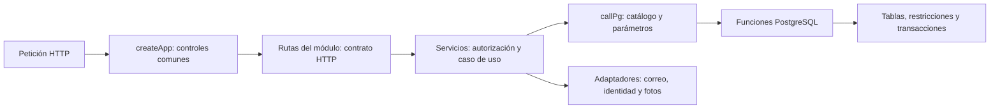
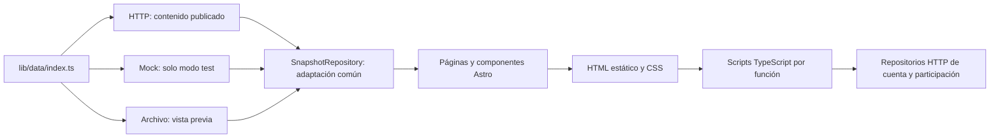

# Auditoría de arquitectura y organización

Fecha: **22 de octubre de 2026**. Referencia de código: `1638f79ba77f057f55f26439ee91afb0a8da2782`. Informe interno en español; las referencias `archivo:línea` corresponden a esta revisión y pueden desplazarse con cambios posteriores.

## 1. Dictamen y alcance

**Conviene conservar la arquitectura actual y corregir problemas concretos por etapas.** El backend es un monolito modular con servicios de aplicación y funciones PostgreSQL; el frontend es un sitio estático Astro con componentes y adaptadores de datos, más interacciones TypeScript. Esta combinación sirve al alcance actual sin requerir microservicios, otro framework, un contenedor de inyección ni una reorganización completa.

El cumplimiento global de **DRY y SRP es parcial**: existen fuentes compartidas, módulos cohesivos y separación HTTP/servicio/persistencia, pero también validaciones duplicadas, un ciclo entre servicios y responsabilidades transversales ubicadas en contenido. **KISS y YAGNI se cumplen en las decisiones principales revisadas**. No se ha demostrado que el número de archivos, la ausencia de clases de controlador o el uso de SQL sean por sí mismos problemas.

Se reprodujeron dos defectos acotados: un reintento de sugerencia consume otra unidad del límite de envíos y la edición de un formulario puede habilitar su botón mientras el guardado sigue pendiente. La protección transaccional evita duplicados o sobrescrituras en los casos probados, pero eso no vuelve correctos esos dos comportamientos de aplicación.

Se revisaron backend, frontend, SQL, contratos, pruebas, despliegue y los **17 Markdown preexistentes de `docs/`**, incluidas las dos guías locales ignoradas por Git. `design/` quedó **fuera de alcance y no se inspeccionó**. Las guías privadas se contrastaron sin reproducir credenciales, direcciones privadas ni detalles personales. Este informe añade un decimoctavo Markdown.

**Único cambio entregado:** este archivo. No se aplicaron refactorizaciones ni se eliminaron documentos. No se cambiaron APIs, esquemas, dependencias, diseño o despliegue; tampoco se hicieron commits ni se accedió a producción. Las pruebas usaron recursos locales desechables, retirados al finalizar.

Estados utilizados:

- **Cumplido:** hay implementación y evidencia dentro del alcance indicado; no implica una garantía universal.
- **Parcial:** la separación o protección existe, con excepciones concretas.
- **Incumplido:** se observa una contradicción verificable con el requisito.
- **No verificado:** falta ejecución o evidencia suficiente; no se presenta como defecto confirmado.

## 2. Arquitectura real y límites de responsabilidad

### 2.1 Backend: módulos con servicios y funciones SQL



[backend/src/app.ts:18](../backend/src/app.ts#L18) compone explícitamente `sql`, `config`, `mailer` y `security`; crea los servicios y monta `auth`, `admin`, `profile`, `content`, `participation` y `stats`. Sus controles comunes incluyen origen de las peticiones (`:23`) y traducción defensiva de errores (`:29`, `http-errors.ts`). Esto es un punto de composición reconocible, sin un registro global de dependencias.

Las carpetas `routes/` y `services/` están **dentro de cada módulo funcional**, no agrupadas globalmente por tipo técnico. Las rutas desempeñan el papel de controladores: extraen cookies/parámetros, validan el cuerpo con Elysia, invocan el servicio y adaptan la respuesta. Ejemplo completo: `profile/routes/index.ts` → `createProfile` en `profile/services/profile.ts:11` → `callPg(..., 'profileUpdate', ...)` → `fn_profile_update` en `database/fn.sql:384`.

Los servicios contienen los casos de uso; no existe una capa independiente llamada `use-cases/`. Tampoco hay repositorios de backend por agregado: **`db/call.ts:104` es una pasarela de llamadas SQL**, con catálogo permitido y parámetros separados. La implementación depende directamente de `SQL` de Bun y de errores de aplicación HTTP. No corresponde describirla como Clean Architecture o arquitectura hexagonal completa, aunque tiene límites útiles y adaptadores inyectados.

PostgreSQL contiene parte sustancial de las reglas: permisos, idempotencia, versiones, bloqueo y auditoría. Drizzle describe estructura y migraciones (`db/schema.ts`, `drizzle/`); no sustituye las funciones transaccionales. Esa distribución es válida si la documentación reconoce dónde vive cada regla y las pruebas ejecutan SQL real, como ocurre aquí.

### 2.2 Edición, publicación y compilación

1. El panel usa [frontend/src/lib/data/http/admin-api.ts](../frontend/src/lib/data/http/admin-api.ts) y `api-client.ts` para guardar un borrador con su versión.
2. El servicio valida permiso y contenido; la función SQL compara versiones bajo bloqueo y devuelve conflicto si corresponde. `content/services/content.ts:85` traduce el resultado a 409.
3. `content.ts:202` prepara la publicación; `fn_publication_create` (`fn.sql:862`) conserva un snapshot y agrupa/reutiliza trabajos conforme al estado y contenido.
4. `publisher/worker.ts` toma un trabajo, ejecuta el build Astro en una salida nueva y llama a `publisher/salida-estatica.ts` para sustituir la salida y retener recursos necesarios para pestañas anteriores.
5. La compilación normal lee `GET /api/contenido/publicado`. Para la vista previa se escribe un snapshot temporal y se usa `CONTENIDO_ARCHIVO`; la autorización de acceso a la vista previa sigue en la API/proxy.

La sustitución de archivos y la finalización SQL **no forman una única transacción distribuida**. `fn_publication_current` (`fn.sql:911`) admite `publicando` para que el build lea el candidato; durante ese intervalo la API puede ofrecer esa versión mientras los HTML todavía corresponden a la anterior. Es el mecanismo actual, no prueba de atomicidad entre API, base y archivos.

La configuración sirve **un publicador**. `SKIP LOCKED` protege la toma de trabajos, pero no convierte en seguros varios procesos que comparten las mismas rutas `dist-nueva`, `dist-anterior` y el archivo de vista previa. Mantener esa topología; no introducir escalado horizontal por una supuesta necesidad futura.

### 2.3 Frontend: repositorio, página e interacción



[frontend/src/lib/data/index.ts:10](../frontend/src/lib/data/index.ts#L10) selecciona implementaciones de `ContentRepository`; `SnapshotRepository` (`snapshot-repository.ts:17`) concentra transformaciones. Las páginas no hacen `fetch` directo de datos de negocio. Las diferencias entre nombres del API y modelos de vista son adaptaciones legítimas, no una razón para forzar el mismo objeto en todas las capas.

`HttpContentRepository.load` (`http/http-content-repository.ts:9`) comparte la carga del snapshot y limita su caché en desarrollo. En `:13` falla ante respuestas no exitosas: **no existe fallback público a datos de prueba cuando la API devuelve 404**. `FileContentRepository` permite compilar una vista previa concreta; el mock usa la semilla existente en modo de pruebas.

La estructura técnica exigida por Astro (`pages`, `layouts`, `components`, `scripts`) se conserva, con subcarpetas funcionales `cuenta`, `ciudadania`, `propuestas`, `acerca-de-nosotros`, etc. No es conveniente mover rutas fuera de `pages/` para simular una arquitectura distinta. Los scripts manejan DOM/estado de interfaz; los repositorios encapsulan operaciones de datos. Las descargas de modelos y animaciones no son lecturas de negocio que deban pasar por un repositorio.

### 2.4 Patrones presentes y utilidad

| Patrón comprobado | Evidencia | Valoración |
| --- | --- | --- |
| Factorías y composición explícita | `createApp`, `createAuthorization`, `createProfile`, factorías de servicios | **Cumplido.** Crean dependencias en un sitio visible, sin contenedor ni decoradores propios. |
| Inyección de adaptadores | `createApp({sql, config, mailer, security})`; fixtures en [backend/tests/helpers.ts](../backend/tests/helpers.ts) | **Cumplido.** Permite SQL real y dobles controlados de correo/Google. No equivale a desacoplar todos los servicios de PostgreSQL. |
| Repositorio y adaptadores de frontend | `content-repository.ts`, implementaciones HTTP/mock/archivo y repositorios de cuenta/participación | **Cumplido.** La variación real de fuentes justifica las interfaces. |
| Método plantilla | `SnapshotRepository`, método `load` implementado por tres adaptadores | **Cumplido.** Reutiliza transformaciones concretas; no es una jerarquía especulativa. |
| Pasarela de funciones SQL | Catálogo de [backend/src/db/call.ts](../backend/src/db/call.ts) y `callPg` | **Parcial en tipado.** Evita SQL disperso y nombres arbitrarios; `unknown[]` y el genérico del llamador no verifican cada firma SQL. |
| Cola persistente y snapshot editorial | `fn_publication_create`, `publicationClaim`, worker y salida estática | **Cumplido para la topología actual.** No es event sourcing, un bus de eventos ni microservicios. |
| Control optimista e idempotencia | Versiones/valores esperados, claves únicas, bloqueos SQL | **Parcial en el conjunto aplicación/interfaz.** El soporte SQL es sólido en los escenarios probados; H1 y H2 son excepciones de aplicación. |

## 3. Principios de ingeniería: evidencia y límites

### 3.1 DRY: fuentes de verdad y duplicaciones

| Área | Estado | Fuente y evidencia concreta |
| --- | --- | --- |
| Contenido inicial | **Cumplido** | [backend/database/contenido-inicial.json](../backend/database/contenido-inicial.json) alimenta `db/seed.ts`; [frontend/src/lib/data/mock/mock-content-repository.ts:2](../frontend/src/lib/data/mock/mock-content-repository.ts#L2) reutiliza esa semilla. La API/panel y medios son el camino del contenido editable. Las fotos de fixtures no constituyen otro CMS. |
| Textos predeterminados y publicaciones | **Cumplido** | Semilla, datos iniciales de base y snapshot; `content.ts:89` obtiene originales. El catálogo del editor describe campos/límites, no debe volver a almacenar copias paralelas del contenido. |
| Contratos legales, redes y video | **Cumplido con acoplamiento explícito** | `backend/src/contracts/{legal,redes,video}.ts` son módulos puros. Los reexportan [frontend/src/lib/legal/legal.ts:2](../frontend/src/lib/legal/legal.ts#L2), `lib/comun/contenido/redes.ts:2` y `lib/acerca-de-nosotros/acerca-de-carlos/reproductor.ts:1`. Su ubicación obliga a compilar con el árbol backend presente; H7. |
| Contraseñas | **Parcial** | [backend/src/auth/password-policy.ts:4](../backend/src/auth/password-policy.ts#L4) y [frontend/src/lib/cuenta/auth/password.ts:1](../frontend/src/lib/cuenta/auth/password.ts#L1) implementan la misma política. [backend/tests/password-policy.test.ts:8](../backend/tests/password-policy.test.ts#L8) compara ambos y pasó; detecta divergencias, pero no elimina las dos fuentes; H5. |
| Autorización | **Cumplido en las rutas revisadas** | `auth/services/authorization.ts:8` centraliza identidad/permisos; catálogo en `auth/permissions.ts`. Repetir la protección en SQL para mutaciones sensibles es defensa necesaria, no duplicación a eliminar. |
| Transporte HTTP del navegador | **Cumplido** | [frontend/src/lib/data/http/api-client.ts:20](../frontend/src/lib/data/http/api-client.ts#L20) comparte renovación en curso; `:27` centraliza petición, errores y reintento. Las dos pruebas unitarias comprueban renovación única y ausencia de renovación al fallar el login. |
| Transformaciones de contenido | **Cumplido con excepciones de tipos** | `SnapshotRepository` evita repetir mapeos en mock/HTTP/archivo. `UploadedPicture`, `Photo` y los tipos de página de presentación conservan estructuras duplicadas; H6. |
| Nombres de variantes fotográficas | **Parcial** | [backend/src/content/services/media.ts:62](../backend/src/content/services/media.ts#L62) fija 760 y `:63` el nombre; [frontend/src/lib/comun/fotos.ts:10](../frontend/src/lib/comun/fotos.ts#L10) documenta la dependencia y vuelve a construirlo. Existe acoplamiento por convención; H6. |
| Estructura SQL y su historial | **Cumplido como ciclo de migraciones** | `schema.ts`, SQL generado y snapshots `drizzle/meta` cumplen funciones distintas. No son copias prescindibles por aplicar DRY; borrar historial rompe actualizaciones. |
| Reglas para agentes | **Parcial en mantenimiento** | `AGENTS.md` y `CLAUDE.md` tienen contenido idéntico en esta revisión. Cada cliente puede necesitar su archivo; conservarlos sincronizados y evitar una tercera copia, sin eliminar ninguno automáticamente. |

La validación de formulario mejora la experiencia; el servidor debe volver a validar datos no confiables y SQL debe mantener restricciones transaccionales. Compartir una función pura cuando la regla es idéntica no significa retirar esas barreras. Tampoco se propone importar `sharp`, `SQL` o configuración privada en el frontend para reutilizar un pequeño tipo o formato de nombre.

### 3.2 SRP y cohesión

| Límite | Estado | Evaluación |
| --- | --- | --- |
| Ruta/controlador → caso de uso | **Cumplido en general** | Rutas por módulo con esquema HTTP, delegación a servicios y manejo común de errores en `app.ts`. No necesita clases nuevas de controlador. |
| Servicio → persistencia | **Parcial** | El caso de uso valida y coordina; las funciones SQL implementan parte del negocio. La dependencia de Bun SQL es directa y consciente, no un repositorio abstracto inexistente. |
| Cohesión SQL | **Parcial** | `database/fn.sql` reúne unas 1.299 líneas de autenticación, contenido, participación, estadísticas y publicación. El problema potencial es la mezcla de motivos de cambio, no la cifra de líneas; H8 propone una separación opcional con el mismo cargador. |
| Servicio de contenido | **Parcial** | `content/services/content.ts` tiene unas 274 líneas: snapshot (`:41`), varios guardados, diferencias y publicación (`:191`, `:202`). Comparte el ciclo editorial, por lo que no todo debe fragmentarse; sí existe el ciclo comprobado con `about-carlos.ts`; H4. |
| Dependencias entre módulos | **Parcial** | Registro (`auth/services/registration.ts:12`), perfil (`profile/services/profile.ts:9`) y participación consumen `content/services/validation.ts`. La validación de texto plano es transversal; ubicarla en contenido comunica una dependencia de negocio innecesaria; H4. |
| Procesamiento de fotos | **Parcial** | `content/services/media.ts` reúne Sharp, archivos, variantes y persistencia autorizada; participación reutiliza parte del procesamiento. Extraer un procesador puro respecto de SQL solo si se modifica ese flujo; no crear un servicio externo de imágenes. |
| Componente → script de navegador | **Parcial** | Astro compone la vista, pero `scripts/comun/layout.ts` reúne navegación/accesibilidad y `scripts/cuenta/index.ts` varios flujos de cuenta. Es cohesión por pantalla con varias razones de cambio; extraer inicializadores pequeños cuando una modificación lo requiera. H2 es una separación de estados ya necesaria. |
| Responsabilidad de CSS | **Parcial respecto de AGENTS.md** | Tokens y utilidades son el sistema principal. SVG de `citizen-strip.css`, nodos dinámicos y modos de accesibilidad justifican CSS propio. Márgenes/tamaño sobre markup estático en `styles/forms.css:5`, `:9`, `:14` son excepciones a la regla local; H9. |

### 3.3 KISS y YAGNI: herramientas justificadas por uso

Esta tabla justifica el uso encontrado; no pretende demostrar que cada herramienta sea universalmente la mejor ni recomienda actualizar versiones. Los manifiestos y locks fijan lo efectivamente usado.

| Herramienta | Uso comprobado y lugar de ejecución | Decisión para el alcance actual |
| --- | --- | --- |
| Bun y Elysia | Servidor, SQL, scripts y pruebas; composición y esquemas HTTP en backend | Conservar. Sustituir runtime/router sería una migración sin beneficio demostrado. |
| PostgreSQL 17 | Transacciones, restricciones, bloqueo, persistencia y cola editorial | Conservar; no añadir Redis o un broker para la cola existente. |
| Drizzle ORM y drizzle-kit | `db/schema.ts`, `db/migrate.ts`, configuración e historial de migraciones | Conservar. ORM/migrador y funciones SQL son responsabilidades distintas, no dos persistencias. `pg` sirve al tooling; no constituye un segundo repositorio de negocio. |
| jose | Firma/verificación de JWT e identidad externa en `security.ts` | Conservar; no reemplazar criptografía por una implementación propia. |
| nodemailer | `mailer.ts`, correo de cuenta y transporte SMTP probado | Conservar. No hace falta una plataforma adicional de mensajería. |
| sharp | Decodificación, normalización y variantes de fotos en `content/services/media.ts` | Conservar en servidor; nunca trasladarlo al cliente. |
| Astro | Rutas, componentes, imágenes y generación estática | Conservar. El framework de compilación no se envía entero al navegador. No añadir React/Vue para formularios ya cubiertos. |
| Tailwind v4 y plugin Vite | Compilan utilidades, tokens y variantes de `styles/global.css` | Conservar; no añaden un runtime de UI. No incorporar DaisyUI ni otra biblioteca visual. |
| Fuentes `@fontsource/*` | Tipografías servidas localmente desde estilos | Conservar las fuentes aprobadas; no crear llamadas a un proveedor externo para sustituirlas. |
| `@google/model-viewer` y `meshoptimizer` | Visor y decodificación de modelos comprimidos, cargados condicionalmente por `Model3D.astro` | Justificados para el visor existente. Mantener carga diferida y reintento, medir cada nuevo modelo. |
| `lottie-web` | Versión light mediante `lib/comun/animaciones.ts`, portada/transiciones/esperas | Tiene uso real y diseño aprobado; mantener el cargador compartido y `reduce-motion`. No retirarlo por el mero tamaño del paquete instalado. |
| `@gltf-transform/cli` | `scripts/optimizar-modelos.ts` | Herramienta de preparación, no código de navegación. Mantener originales y salida optimizada separadas. |
| Playwright | Pruebas y generación de pósters (`scripts/generar-posters.ts`) | Herramienta de desarrollo; no incluir su peso en el presupuesto descargado por el público. |
| TypeScript, `@astrojs/check`, tipos | Comprobación estática y tooling | Conservar; no generan un framework de cliente. |
| `prettier-plugin-astro` | Configuración de formato `.prettierrc.json` | Uso de editor/desarrollo; no afecta la web compilada. |
| Docker, Compose, Nginx, Actions | Aislamiento operativo, proxy/archivos y flujo de despliegue | Mantener. No hace falta Kubernetes ni un gestor adicional de monorepo para dos paquetes. |

Medición de **archivos emitidos en esta compilación**, sin sumar paquetes instalados:

| Recurso | Bytes sin comprimir | Bytes con gzip calculado localmente |
| --- | ---: | ---: |
| Chunk `model-viewer.min` | 1.068.903 | 291.816 |
| Chunk `lottie_light.min` | 168.236 | 46.756 |
| CSS de `Layout` | 95.561 | 18.841 |
| Script de la página del panel | 85.819 | 23.720 |
| Script de modo edición | 9.526 | 3.806 |

Son tamaños de artefactos y una estimación gzip, **no una medición de transferencia inicial ni de Brotli en producción**. No todas las páginas cargan todos esos chunks. Las pruebas de navegador verificaron que el visor no se solicita en páginas que no lo usan y que existen reintentos. Falta medir rendimiento en un móvil físico de gama baja y red limitada; eso no justifica ahora cambiar de visor ni de framework.

### 3.4 Seguridad, idempotencia y concurrencia

La revisión encontró barreras complementarias: esquemas estrictos de entrada, `plainText`, normalización de enlaces en contratos puros, autenticación con `jose`, consulta de permisos vigentes, control de origen y errores públicos defensivos. `security.ts:15` construye el adaptador; `auth/services/authorization.ts:8` concentra autorización. La renovación utiliza rotación y almacenamiento de hash. No se presume que cerrar sesión invalide inmediatamente un JWT de acceso ya emitido: su vida corta sigue siendo un límite del diseño documentado.

Ejemplos de garantía en la base, no solo en botones:

- `fn_profile_update` (`fn.sql:384`) bloquea la fila, compara versión y evita incrementar versión/auditoría en un guardado idéntico. Las pruebas incluyen dos actualizaciones simultáneas distintas y repetidas iguales.
- `fn_proposal_save` (`:705`) protege el guardado conjunto y la versión mediante bloqueo transaccional; el servicio devuelve 409 con un mensaje de recarga.
- `fn_publication_create` (`:862`) evita crear otra publicación equivalente y agrupa la cola.
- `fn_chat_send` (`:1117`) conserva el comprobante/respuesta y contabiliza una sola vez los reintentos concurrentes; se comprobó rollback si falla el registro asociado.
- `fn_suggestion_create` (`:1203`) evita duplicar filas por clave; H1 muestra por qué esa propiedad no cubre automáticamente el limitador previo del servicio.

`database/permisos.sql` separa roles operativos. Las pruebas de permisos ejecutan `SET LOCAL ROLE`: el publicador tiene funciones limitadas, la API no modifica el esquema y consulta es de solo lectura. Las funciones son `SECURITY INVOKER` y el rol de aplicación conserva acceso de datos; **no se afirma que toda autorización esté blindada ante cualquier SQL arbitrario ejecutado con ese rol**. La garantía observada corresponde a rutas, servicios, funciones y restricciones en conjunto.

## 4. Hallazgos y recomendaciones acotadas

Prioridades: **P1** corregir comportamiento demostrado; **P2** mantenimiento o prevención cercana; **P3** aplazable. Ninguna prioridad de este informe autoriza cambiar producción ni sustituye pendientes acordados en otros documentos.

### Correcciones necesarias por problemas demostrados

**H1 · P1 · Los reintentos de sugerencias consumen el cupo de nuevos envíos — incumplido.**

- **Evidencia:** [backend/src/participation/services/participation.ts:98](../backend/src/participation/services/participation.ts#L98), especialmente `limit(...)` en `:103`, se ejecuta antes de recuperar/crear por clave en SQL. En una base exclusiva, siete POST válidos con la misma clave y cuerpo dieron `[200, 200, 200, 200, 200, 429, 429]`; quedó una sola fila y un único identificador. La prueba actual `tests/participation.test.ts:93` repite, pero no atraviesa ese límite con una sola clave.
- **Consecuencia:** una red inestable puede gastar el cupo de la persona sin crear nuevos envíos. Hay idempotencia de filas, pero no del efecto del limitador.
- **Cambio mínimo:** recuperar el envío existente del mismo usuario/clave antes de consumir el límite, manteniendo autorización y consentimiento. Conservar unicidad SQL y hacer que los reintentos concurrentes de la misma clave compartan el resultado sin consumir varias unidades. La consulta previa sola no demuestra esta última propiedad: validarla y, si hace falta, coordinar esa clave en el limitador actual. No mover simplemente el límite después del INSERT, pues podría guardarse algo y responder 429.
- **Riesgo de producción:** bajo/medio; una corrección mal ordenada podría permitir envíos nuevos sin límite. No cambia el contrato público ni necesita Redis.
- **Comprobaciones:** repetir una clave más de cinco veces; reintentos concurrentes; una clave existente con cupo agotado; claves nuevas limitadas; separación por usuario; rechazo sin permiso/consentimiento. El resultado, contador y efectos deben ser estables, no solo el número de filas.

**H2 · P1 · La detección de cambios puede habilitar Guardar durante la petición — incumplido.**

- **Evidencia:** [frontend/src/lib/cuenta/panel/cambios.ts:13](../frontend/src/lib/cuenta/panel/cambios.ts#L13) modifica `disabled` según la diferencia con la base; `scripts/cuenta/panel/ui.ts:89` deshabilita temporalmente, pero no tiene una guarda de reentrada. Ambos se combinan en `scripts/cuenta/panel/propuestas/index.ts:91` y `:98`.
- **Reproducción:** con respuesta PUT demorada, editar, guardar y volver a escribir deja el botón habilitado antes de recibir respuesta. Otro clic genera dos PUT pendientes. Se reprodujo en desarrollo y en la compilación normal, con el doble HTTP del panel.
- **Consecuencia:** peticiones duplicadas, respuestas fuera de orden y conflictos evitables. No se demostró pérdida de datos: la comprobación SQL de versión sigue protegiendo el guardado.
- **Cambio mínimo:** un único estado `pendiente` por formulario/acción, una guarda de reentrada en `busy` y cálculo de habilitación que combine cambios y petición pendiente. Al terminar, recalcular el estado respecto de la base vigente; ante 409 conservar lo escrito y explicar el conflicto. Reutilizar el mecanismo en los formularios que ya comparten esas funciones.
- **Riesgo de producción:** bajo; afecta interacción, sin cambio visual ni API. Evitar que el botón quede habilitado incondicionalmente en `finally`.
- **Comprobaciones:** respuesta lenta + edición + doble clic/Enter produce una petición; error permite reintentar; éxito sin cambios deja Guardar deshabilitado; 409 conserva valores. Revisar formularios de propuestas, biografía, obras y páginas de presentación.

**H3 · P2 · La documentación describe un fallback y una selección de repositorios que ya no existen — incumplido.**

- **Evidencia:** `docs/como-funciona-la-publicacion.md:326` y `:362`/`:374` explican dos fuentes y fallback de 404 a la semilla; [frontend/src/lib/data/index.ts:10](../frontend/src/lib/data/index.ts#L10) selecciona tres y `http-content-repository.ts:13` lanza error. Su sección 5.3 no basta para garantizar varios publicadores sobre las mismas rutas.
- **Consecuencia:** puede diagnosticarse o desplegarse el sistema con supuestos operativos incorrectos.
- **Cambio mínimo:** actualizar ejemplos al flujo actual, añadir archivo de vista previa, documentar la semilla inicial y el fallo explícito ante indisponibilidad de API, y fijar la restricción de un publicador. No cambiar código para adaptarlo al documento viejo.
- **Riesgo:** nulo en ejecución; bajo en documentación si se revisan enlaces y ejemplos. **Comprobaciones:** contrastar selector, servicio publicado, worker y Compose; ejecutar los ejemplos de lectura únicamente contra un entorno aislado.

### Mejoras pequeñas de organización y mantenimiento

**H4 · P2 · Ciclo real y utilidad transversal dentro de contenido — parcial.**

- **Evidencia:** `content/services/content.ts:7` importa `listAboutCarlosPages`; `about-carlos.ts:8` importa `CONTENT_CONFLICT` de `content.ts:13`. Registro y perfil dependen de `content/services/validation.ts` para `plainText`.
- **Consecuencia:** modificar contenido arrastra dependencias ajenas; el ciclo dificulta inicialización y pruebas aisladas, aunque no provocó fallo en esta ejecución.
- **Cambio mínimo:** extraer solo el mensaje común a `backend/src/content/conflictos.ts` y `plainText` a `backend/src/validation/texto.ts`. Mantener validaciones editoriales dentro de `content`. No crear un cajón `utils` ni dividir cada función en su propio archivo.
- **Riesgo:** bajo; cambia imports internos dentro del `src` que ya copia Docker. **Comprobaciones:** buscar todos los importadores, check y pruebas de validación/registro/perfil/contenido; mismo error y mismos valores normalizados. Reversión: restaurar imports y ubicaciones, sin SQL ni datos.

**H5 · P2 · Política de contraseña duplicada — parcial.**

- **Evidencia:** los dos validadores y su prueba de paridad señalados en §3.1.
- **Consecuencia:** una regla nueva puede quedar implementada solo en el navegador o solo en la API.
- **Cambio mínimo:** función pura en el directorio existente `backend/src/contracts/password.ts` que devuelva el resultado de validación; los adaptadores conservan sus errores/mensajes y la confirmación. No cambiar requisitos de contraseña como parte de este refactor.
- **Riesgo:** bajo/medio por afectar registro y recuperación. **Comprobaciones:** conservar casos exhaustivos de sucesiones/composición/confirmación, login de contraseñas existentes y build frontend. Usar imports solo del contrato puro; reversión sin migraciones.

**H6 · P2 · Tipos y formato de variantes repetidos — parcial.**

- **Evidencia:** [frontend/src/lib/data/types.ts:11](../frontend/src/lib/data/types.ts#L11) (`UploadedPicture`), `http/admin-api.ts:4` (`Photo`), `data/acerca-de-carlos.ts:4` y `admin-api.ts:18`; nombre de foto en [backend/src/content/services/media.ts:63](../backend/src/content/services/media.ts#L63) y [frontend/src/lib/comun/fotos.ts:11](../frontend/src/lib/comun/fotos.ts#L11).
- **Consecuencia:** deriva de contratos de compilación y de URLs si se cambia un lado.
- **Cambio mínimo:** primero reutilizar tipos equivalentes dentro del frontend mediante `import type`; luego, si se toca el formato de fotos, una función pura en `backend/src/contracts/media.ts` para el nombre. No unificar modelos de vista distintos ni importar el procesador Sharp en navegador.
- **Riesgo:** bajo para tipos; medio para URLs. **Comprobaciones:** check/build, subida de una foto, srcset y variante de tarjeta, imágenes existentes y compatibilidad de nombres. No renombrar archivos subidos ni regenerar medios históricos.

**H7 · P2 · Contratos compartidos con dependencia de la ubicación del backend — parcial; conservar por ahora.**

- **Evidencia:** imports relativos frontend → `backend/src/contracts`; [server-produccion/Dockerfile.publicador:14](../server-produccion/Dockerfile.publicador#L14)–`:16` copia frontend, backend/src y database. La imagen de API usa contexto `backend` en [.github/workflows/despliegue.yml:98](../.github/workflows/despliegue.yml#L98).
- **Consecuencia:** no puede distribuirse el frontend como carpeta autosuficiente; mover a un paquete raíz `shared` rompería la imagen de API si no cambia su contexto y copia.
- **Cambio mínimo:** documentar ese contrato de compilación y limitar imports cruzados a módulos puros. Conservar la ubicación mientras ambos proyectos se entreguen juntos. `shared/` local está vacío: no representa una capa compartida implementada.
- **Riesgo de un traslado:** medio, por rutas, Docker, locks y CI; no recomendado ahora. **Comprobaciones si se hace en el futuro:** ambas imágenes desde checkout limpio, ambos checks, builds normal/prueba/archivo y publicación aislada. SQL y permisos no cambian por mover código puro; los contratos externos deben mantenerse. Revertir todo el cambio de empaquetado junto, sin una transición con fuentes duplicadas.

**H8 · P3 · Concentración SQL y amplitud editorial — mejora aplazable.**

- **Evidencia:** `database/fn.sql`, `content/services/content.ts:41`, `:191`, `:202`; `db/migrate.ts:15` enumera scripts y `:70` aplica migraciones y scripts transaccionales.
- **Consecuencia:** modificaciones de dominios distintos concurren sobre un archivo SQL; servicio editorial comparte lecturas, guardados y publicación. No se comprobó que su tamaño cause un defecto.
- **Cambio mínimo cuando exista una modificación funcional que lo justifique:** dividir funciones en `backend/database/funciones/{auth,admin,perfil,contenido,participacion,estadisticas,publicacion}.sql`, con listado explícito y ordenado en el cargador actual, misma transacción y mismas firmas. En TypeScript separar publicación/diferencias solo si su evolución requiere un límite propio. No añadir capas genéricas de repositorio.
- **Riesgo:** medio en SQL. Conservar `drizzle/`, semilla, privilegios y orden de dependencias; Bun ejecuta strings, por lo que no se pueden introducir directivas `\i` de psql. No dejar definiciones activas duplicadas en `fn.sql` y los nuevos archivos.
- **Comprobaciones:** instalación vacía, actualización de copia desechable del esquema anterior, migración repetida, permisos, definiciones SQL equivalentes y publicación. Docker ya copia `database/`, pero revisar exclusiones y loader. Reversión del movimiento: restaurar el único archivo y su cargador conservando las definiciones; nunca borrar migraciones aplicadas.

**H9 · P3 · Ajustes de CSS, nombres y comentarios frente a las reglas locales — parcial.**

- **Evidencia:** reglas estáticas de `styles/forms.css:5`/`:9`/`:14`; nombres personales `content/services/about-carlos.ts`, `lib/acerca-de-nosotros/acerca-de-carlos/`, `AboutCarlos*`; comentarios que narran funciones en servicios/scripts frente a la regla local de comentar solo el porqué.
- **Consecuencia:** inconsistencia de convenciones y mayor coste al localizar responsabilidades. Ninguno exige rediseño.
- **Cambio mínimo:** al tocar cada módulo, pasar únicamente reglas estáticas equivalentes a utilidades; usar nombres funcionales para archivos nuevos; retirar comentarios redundantes en líneas que se estén modificando. Un eventual nombre interno como `paginas-presentacion` debe ser un cambio aislado con todos sus imports. Mantener slugs, API, columnas, migraciones y material original.
- **Riesgo:** bajo para comentarios, medio para CSS/renombres. **Comprobaciones:** capturas antes/después idénticas en 320/390/768/1440 y límites del breakpoint tocado, por ejemplo 759/760/761; ocho modos; rutas generadas e imports. Revertir la conversión si altera píxeles. No normalizar breakpoints o espaciados aprobados por criterio estético.

**H10 · P2 · Las pruebas unitarias del cliente HTTP no están en CI — incumplido respecto de una verificación continua completa.**

- **Evidencia:** [frontend/package.json](../frontend/package.json) define `test:unit`; [.github/workflows/despliegue.yml:68](../.github/workflows/despliegue.yml#L68)–`:70` ejecuta check y Playwright, sin ese comando. Se ejecutaron ahora las dos pruebas y pasaron.
- **Consecuencia:** la renovación compartida de sesión puede retroceder sin que se ejecute su prueba específica en cada despliegue.
- **Cambio mínimo:** un paso `bun run test:unit` antes de Playwright, con el directorio de trabajo frontend actual. **Riesgo:** bajo, solo puede detener CI ante fallos. **Comprobaciones:** el comando con el Node del runner y el workflow de pruebas; no cambiar condiciones ni comandos de despliegue.

### Cuestiones que requieren evidencia antes de cambiar código

**H11 · P3 · Consistencia del snapshot bajo edición simultánea — no verificado dinámicamente.** `content/services/content.ts:41` lee agregados mediante `Promise.all` y consultas separadas; las versiones se obtienen también por otra llamada (`:107`). Eso no demuestra una lectura única bajo una transacción de aislamiento repetible. Podría mezclarse información si hay escrituras durante la captura; no se reprodujo una publicación incoherente. Antes de modificarlo, crear una prueba determinista que intercale cambios y capture el snapshot. Solo si falla el contrato esperado, envolver lectura/versiones en una transacción de lectura coherente o una función SQL concreta. Riesgo medio por latencia/aislamiento; validar publicación, vista previa y conflictos. No añadir transacciones indiscriminadas a todas las lecturas.

**H12 · P3 · Tipado de `callPg` — parcial, sin fallo demostrado.** `db/call.ts:104` admite argumentos `unknown[]` y deja que el llamador elija `T`. El compilador no detecta una firma SQL mal ordenada. Mantener el gateway y los tests reales; añadir firmas explícitas solo a las operaciones modificadas o propensas a error, si aporta valor. Evitar un generador de repositorios o duplicar todo el esquema SQL en TypeScript. Riesgo bajo/medio; comprobar firmas, resultados nulos y errores SQL con integración. No requiere cambios de Docker, privilegios o contratos públicos.

## 5. Aplicación gradual y reversibilidad

| Etapa propuesta | Alcance concreto | Condición de salida y reversión |
| --- | --- | --- |
| 1 | H1 y H2, por separado | Regresiones específicas de repetición y formulario pendiente, más suites existentes. Revertibles en código; preservar claves, versiones, respuestas y mensajes. |
| 2 | H3 y tabla documental; H10 | Documentación y un paso de pruebas. Revisar referencias entrantes. No tocar infraestructura de producción. |
| 3 | H4, después H5 y deduplicación interna de H6 | Cambios pequeños de imports/tipos, con check/test/build e imágenes Docker si cambia el empaquetado. Reversión sin migración. |
| 4 | H8, H9, H11 y H12 solo al justificarse | Un módulo a la vez, hipótesis probada y equivalencia de comportamiento/visual. Evitar un PR que mezcle SQL, carpetas y CSS. |

Para movimientos internos, localizar referencias en código, pruebas, scripts, Dockerfiles y guías antes de mover; comprobar imports después. Mantener los contextos de construcción actuales (`backend` para API y raíz para publicador), las copias `src/database/drizzle` y los comandos de CI. Los cambios SQL deben conservar grants y orden de carga; los de publicación deben comprobar salida nueva/anterior y conservación de recursos. La semilla continúa siendo una sola.

[server-produccion/desplegar.sh:35](../server-produccion/desplegar.sh#L35) serializa con `flock` y `:56` respalda la base antes del despliegue. Eso ayuda a operar, pero volver a una imagen anterior **no deshace automáticamente una migración incompatible**. Las recomendaciones inmediatas no necesitan migrar datos. Una separación de archivos SQL debe ser equivalente en definiciones, no una oportunidad para cambiar a la vez el esquema.

Se descartan para este alcance: reescritura por capas formales, CQRS/event sourcing, microservicios, Kubernetes, broker/Redis sin necesidad operativa, framework reactivo de cliente, biblioteca de UI, repositorio genérico CRUD y nuevo paquete compartido con gestor de monorepo. Tampoco se crean carpetas de datos alternativos, ejemplos persistentes ni una segunda semilla.

## 6. Depuración de `docs/`

Se contrastaron contenido, encabezados de estado, referencias entrantes y código. Las referencias se buscaron en README, CHANGELOG, configuración y documentación disponible, incluidas guías ignoradas; no en `design/`, Git, dependencias o salidas generadas. La ausencia de referencias solo vale para ese ámbito. Este informe añade referencias deliberadas a los documentos auditados; no cuentan como dependencias previas.

**Solo `plan-kpis.md` tiene evidencia suficiente para ser eliminable directamente.** No se elimina en esta tarea. Un plan implementado puede conservar decisiones, aprobaciones y pendientes exclusivos; no basta con que su código ya exista.

| Documento | Utilidad actual e información exclusiva | Contradicciones o estado a aclarar | Recomendación y condición para eliminar |
| --- | --- | --- | --- |
| `auditoria-secretos-git.md` | Evidencia histórica fechada y asociada a revisiones/commits concretos. | No prueba que el estado actual o todo el historial futuro esté libre de secretos; esta auditoría no repitió aquel escaneo. | **Conservar.** Eliminar solo si se preserva esa evidencia íntegra en otro registro interno trazable. |
| `aviso-legal-borrador.md` | Decisiones confirmadas sobre identificación/contacto y explicación del contacto publicado compartido mediante `LegalContact.astro`. | `:3` dice que el sitio no está desplegado; `plan-previo-publicacion.md:9` registra despliegue posterior. Parte del texto público ya vive en Astro/contenido. | **Consolidar antes de eliminar.** Llevar decisiones, aprobaciones y verificación pendiente de contactos al registro vigente; conservar enlaces desde los documentos legales/plan y corregir estado. No copiar datos personales en una guía técnica nueva. |
| `como-funciona-la-publicacion.md` | Explicación didáctica del flujo editorial, versiones y publicación. Aporta contexto aunque no tenga referencias entrantes por nombre. | Fallback 404 obsoleto, falta adaptador de archivo y alcance excesivo de varios publicadores; H3. | **Actualizar.** Mantener una explicación canónica; no eliminar mientras cumpla esa función. |
| `guia-despliegue-hostinger.md` — local | Preparación inicial del servidor, servicios y primera instalación. Complementa la operación diaria. | No se verificó el VPS actual; pasos iniciales no deben interpretarse como operaciones a repetir en un servidor ya configurado. | **Conservar**, local y fuera de Git. Solo consolidable si una guía privada de reemplazo conserva instalación, orden y recuperación; no publicar su contenido. |
| `guia.md` — local | Operación cotidiana, consultas, despliegue, respaldos y restauración. Es información operativa no sustituida por el README. | Instrucciones dependientes del entorno deben confirmarse al ejecutarlas; esta revisión no validó credenciales ni estado remoto. | **Conservar**, local y fuera de Git. No eliminar por tamaño ni por solaparse parcialmente con la guía de instalación. |
| `integraciones-pendientes.md` | Lista breve de contenido/modelos aún fijos y limitaciones de componentes en memoria. Referenciada por README backend/frontend. | Parte se solapa con plan 3D y explicaciones de backend; sigue habiendo limitaciones vigentes. | **Consolidar antes de eliminar.** Trasladar cada pendiente al plan activo correspondiente y cada límite al README del subsistema; actualizar ambas referencias. |
| `plan-kpis.md` | Registro de la franja de portada descartada; cabecera `:3` declara expresamente «sustituido». La implementación vigente por propuesta está en semilla, panel y `KpiStrip.astro`. | Mantiene ideas de `getKpis`/endpoint global que no describen el código actual. Las estadísticas vivas de portada son otro concepto. No se encontraron referencias entrantes preexistentes por nombre dentro del ámbito revisado. | **Eliminable.** No contiene un pendiente vigente exclusivo identificado. Comprobar de nuevo referencias justo antes de borrarlo; opcional conservar una frase del descarte en CHANGELOG. No eliminar el componente KPI ni sus datos. |
| `plan-limite-intentos.md` | Motivos de sanciones, recuperación y decisiones de acceso que no se deducen enteramente de los tests. | Mezcla propuesta antigua y ajuste final: umbral de fallos frente a dos IP, referencias de proveedor y componente antiguo. El código vigente es `auth/services/limits.ts`, SQL y controles de bloqueo. | **Consolidar antes de eliminar.** Llevar comportamiento vigente y motivos no obvios a backend README, interacción a frontend README y preservar decisiones; retirar enlaces antiguos después. |
| `plan-modelos-3d.md` | Procedimiento de entrega/optimización, precauciones aprendidas, diseño aprobado y **seis modelos pendientes**. | Ejemplos y medidas iniciales no son mediciones del bundle actual; no hay siete modelos incorporados. | **Actualizar.** Conservar hasta cerrar pendientes y mantener su guía técnica en otra fuente completa; no borrar originales ni automatismos de pósters. |
| `plan-paginas-carlos.md` | Decisiones visuales y editoriales aprobadas, comportamiento de fotos/videos y material real pendiente. | Conviven diseño previo y estado implementado. Las referencias y afirmaciones de comprobaciones «dentro de transacción» deben ajustarse a servicio/SQL reales, sin suponer garantías por el plan. | **Actualizar.** Conservar decisiones y checklist; solo consolidable en una especificación funcional al trasladar todos los pendientes. No basta con que las páginas estén implementadas. |
| `plan-previo-publicacion.md` | Fuente de pendientes operativos, responsables, decisiones y tareas expresamente aplazadas; enlazada desde backend README, la guía de instalación y verificaciones. | Registra evidencias históricas de producción; las pruebas locales actuales no cierran sus seis pendientes ni verifican que sigan resueltos los anteriores. | **Conservar.** Actualizar cada estado solo con evidencia de la tarea correspondiente; no sustituirlo por este informe. |
| `plan-vista-previa.md` | Diseño, resultado implementado, protección del acceso y medición pendiente en servidor. | Las rutas/contratos iniciales no coinciden todos con la implementación final de su sección 6; presentar la parte antigua como decisión histórica. | **Actualizar.** Consolidar la operación actual en la explicación de publicación, manteniendo mediciones y decisiones antes de considerar eliminarlo. |
| `politica-privacidad-borrador.md` | Inventario de tratamiento/almacenamiento, plazos y revisión interna pendiente; excede el texto visible de la página. | Introducción predespliegue obsoleta; asuntos legales anotados requieren su revisión propia. No se validó aquí la exactitud jurídica de esas afirmaciones. | **Actualizar.** Mantener mientras existan decisiones/revisiones exclusivas; el código de la página no sustituye el inventario interno. |
| `revision-privacidad-local.md` | Razonamiento y alcance de la revisión local; decisiones y límites que no deben perderse al limpiar borradores. | Evidencia fechada, no certificación actual ni cierre automático de pendientes operativos. | **Conservar.** Podría recibir decisiones consolidadas, distinguiendo fecha y fuente; no borrar sin conservar trazabilidad. |
| `solicitud-imagen-redes.md` | Encargo de la pieza definitiva y requisitos de formato/composición para el proveedor. | `:10` describe el provisional antiguo; la pieza actual ya tiene formato 1200×630, pero el plan vigente aún registra la entrega definitiva pendiente. | **Actualizar.** Eliminar solo al recibir y aprobar la pieza final, preservar aprobación/requisitos en el registro correspondiente y cerrar el pendiente. No se inspeccionó `design/`. |
| `terminos-condiciones-borrador.md` | Decisiones confirmadas de uso, edad, participación y atención que no deben reconstruirse únicamente desde el texto público. | Duplicación parcial con página/contrato legal y estados históricos. | **Consolidar antes de eliminar.** Preservar decisiones y pendientes en revisión de privacidad/plan vigente, con fecha, y actualizar referencias entrantes. |
| `verificacion-cierre-local.md` | Evidencia histórica de comandos, alcance y aprobaciones; enlaces a antecedentes. | Recuentos antiguos de pruebas no son los ejecutados hoy. No se reabrieron las propuestas visuales excluidas de esta auditoría. | **Conservar.** Mantenerlo fechado; no sustituir sus cifras con las actuales. Puede archivarse con enlaces corregidos, no borrarse por ser anterior. |
| `auditoria-arquitectura.md` — este informe | Diagnóstico, resultados reproducidos y límites de la revisión actual. | Es una instantánea; recomendaciones no aplicadas. | **Conservar.** Al resolver hallazgos, enlazar evidencia de cierre o una revisión posterior sin presentar estas pruebas como nuevas. |

Referencias entrantes por nombre encontradas, excluyendo este informe y las autorreferencias:

| Documento destino | Archivos que lo mencionan |
| --- | --- |
| `auditoria-secretos-git.md`, `aviso-legal-borrador.md`, `solicitud-imagen-redes.md`, `verificacion-cierre-local.md` | `plan-previo-publicacion.md` |
| `guia-despliegue-hostinger.md` | `guia.md` |
| `integraciones-pendientes.md` | `plan-limite-intentos.md`, [backend/README.md](../backend/README.md), [frontend/README.md](../frontend/README.md) |
| `plan-previo-publicacion.md` | `auditoria-secretos-git.md`, `guia-despliegue-hostinger.md`, `verificacion-cierre-local.md`, [backend/README.md](../backend/README.md) |
| `plan-vista-previa.md` | `plan-paginas-carlos.md` |
| `politica-privacidad-borrador.md` | `plan-previo-publicacion.md`, `revision-privacidad-local.md` |
| `revision-privacidad-local.md` | `plan-previo-publicacion.md`, `politica-privacidad-borrador.md`, `terminos-condiciones-borrador.md`, `verificacion-cierre-local.md` |
| `como-funciona-la-publicacion.md`, `guia.md`, `plan-kpis.md`, `plan-limite-intentos.md`, `plan-modelos-3d.md`, `plan-paginas-carlos.md`, `terminos-condiciones-borrador.md` | No se encontraron referencias por nombre dentro del ámbito revisado; su utilidad se evalúa por el contenido, no por este dato aislado. |

Orden sugerido de lectura, sin mover archivos: README del subsistema para arrancar; `como-funciona-la-publicacion.md` para el modelo editorial; `plan-previo-publicacion.md` para pendientes; guías locales para operación privada; auditorías para evidencia histórica. Si falta orientación al entrar al repositorio, un README raíz breve de enlaces sería suficiente y de riesgo bajo; no duplicar ahí las instrucciones completas. No se crea como parte de esta tarea.

## 7. Verificación ejecutada y cobertura real

### 7.1 Aislamiento y comandos

Se creó un **clúster PostgreSQL 17.2 exclusivo**, enlazado a `127.0.0.1:55439`, con bases desechables de nombres generados para tests, API y reproducción. Se eligió un clúster separado porque las pruebas no solo contienen `TRUNCATE`: las de privilegios crean roles de clúster. No se usó la base del usuario ni su PostgreSQL habitual.

La API de auditoría escuchó en `4393`, con semilla real y correo deshabilitado; el frontend de desarrollo en `4394` y la compilación normal en `4395`. El servidor habitual del usuario en `4321` se mantuvo. Playwright usó su puerto aislado `4329`. No se arrancó un publicador contra datos del usuario.

| Ejecución actual | Resultado | Alcance y observaciones |
| --- | --- | --- |
| `backend`: `bun run check` | **Correcto**, código 0 | Comprobación TypeScript. |
| `backend`: `bun run test`, con `TEST_DATABASE_URL` de la base exclusiva | **105 aprobadas, 0 fallidas; 1.152 expectativas; 19 archivos; 32,48 s** | SQL real y migraciones; dobles solo donde los tests los proporcionan. Base eliminada al finalizar. |
| `frontend`: `bun run check` | **Correcto**, 172 archivos; 0 errores, advertencias y sugerencias | Astro/TypeScript. |
| `frontend`: `bun run test:unit` | **2 aprobadas** | Transporte/renovación con `fetch` simulado. |
| `frontend`: `bun run build --outDir dist-auditoria` | **Correcto**, código 0 | Modo normal, `API_PROXY_TARGET=http://127.0.0.1:4393`, sin `CONTENIDO_ARCHIVO`; API real aislada. 28 páginas HTML más robots/sitemap. |
| `frontend`: `bunx playwright test --workers=2` | **108 aprobadas**, código 0 | Edge local; servidor de pruebas propio. La suite incluye además `produccion.spec.ts`, que compila modo normal contra una API HTTP simulada. No es el sitio remoto de producción. |
| Desarrollo: `bun run dev --host 127.0.0.1 --port 4394 --ignore-lock` | **Arranque y navegación correctos** | `--ignore-lock` permite otro servidor sin cerrar el del usuario. |
| Compilado: `bunx astro preview --outDir dist-auditoria --host 127.0.0.1 --port 4395 --ignore-lock` | **Arranque y navegación correctos** | Misma salida normal construida contra la API aislada. |
| Desarrollo: `PLAYWRIGHT_EXTERNAL_SERVER=1`, `PLAYWRIGHT_BASE_URL=http://127.0.0.1:4394`; `bunx playwright test tests/site.spec.ts tests/animaciones.spec.ts --grep '3D\|modelo\|reproductor\|loader\|movimiento' --workers=2` | **11 aprobadas**, 12,5 s | WebGL, carga condicional, recuperación de fallos del visor/modelo y comportamiento de movimiento/loader en desarrollo. |
| Matriz adicional con Playwright | **432 comprobaciones; 0 desbordamientos, 0 errores de página y 0 fallos al activar modos** | Detalle en §7.3. Script y capturas temporales retirados. |
| Reproducciones H1 y H2 | **Defectos confirmados** | Fuera de las suites existentes; sus resultados no convierten la auditoría en «sin problemas» porque las suites pasen. |

Los comandos con variables se ejecutaron con sintaxis PowerShell equivalente; los nombres/credenciales efímeros no se incluyen. La instalación congelada de backend (`bun install --frozen-lockfile`) fue necesaria para comprobar el acceso a dependencias nativas: devolvió **sin cambios**. El sandbox inicialmente impedía resolver `sharp` y copiar caché; con la ejecución autorizada fuera de esa restricción se resolvió y pasaron los tests. No se diagnosticó como defecto de arquitectura ni se modificaron manifests o locks.

La suite de 108 pruebas terminó sus aserciones, pero su cierre de servidor quedó esperando en este entorno Windows. Se comprobó PID, comando y ascendencia del preview de pruebas y se detuvo únicamente ese proceso; el ejecutor finalizó con código 0 y reportó 108 aprobadas (7,9 min totales, incluyendo la espera). Se registra esa intervención; no se presenta la limpieza automática del runner como verificada sin incidencias.

### 7.2 Qué cubren las pruebas y qué no

| Propiedad | Evidencia ejecutada | Límite |
| --- | --- | --- |
| Permisos y jerarquía | [backend/tests/admin.test.ts:41](../backend/tests/admin.test.ts#L41), `:74`, `:97`; `permisos.test.ts:37`–`:68`; pruebas de consentimiento | API/SQL local reales; no auditoría de usuarios o grants del servidor remoto. |
| Entradas inválidas | `http-errors.test.ts:17`, `validation.test.ts`, `video.test.ts`, rutas de fotos y participación | Incluye JSON/esquemas, texto y enlaces; no fuzzing exhaustivo. |
| Repetición y concurrencia | `profile.test.ts:29`, `:46`, `:57`; `content.test.ts:107`, `:207`; `about-carlos.test.ts:71`; `participation.test.ts:149` | SQL y llamadas concurrentes reales. H1 muestra una combinación de reintentos/cupo no cubierta; H2 otra combinación de estados UI. |
| Respuesta 409 | Perfil, contenido, páginas y cambios de rol/estado; escenarios de interfaz existentes | El panel usa dobles HTTP en gran parte de las pruebas; no todas sus pantallas se integraron contra cuentas reales de la API. |
| Renovación de sesión | `auth.test.ts` con base real; [frontend/test-unit/api-client.test.ts:8](../frontend/test-unit/api-client.test.ts#L8) y `:34` | La renovación única del navegador se prueba con `fetch` simulado; no se realizó login real con Google. |
| Correo | `mail.test.ts:28` usa un receptor SMTP local y comprueba rechazo | No se envió correo a proveedores o personas. |
| Publicación y fallos | `content.test.ts:168`, `preview.test.ts:39`, `:54`, `:70`; `publicador.test.ts:26`, `:42`, `:55`, `:69` | Cola/estados y sustitución de archivos probados; build normal real separado. No se ejecutó un ciclo completo del worker en Docker con fallos de disco/red inyectados. |
| Despliegue/rollback | Revisión estática de workflow, Dockerfiles, Compose y shell | **No verificado en ejecución**: imágenes Docker, VPS, Nginx/Cloudflare, DNS/TLS, restauración y rollback real. |

No se calculó un porcentaje de cobertura de líneas. El número de pruebas aprobadas no acredita por sí solo todas las combinaciones ni todos los requisitos de seguridad.

### 7.3 Revisión visual, accesibilidad y carga diferida

Se recorrieron `/`, `/cuenta/registro/`, `/propuestas/tecnologias-emergentes/`, `/ciudadania/sugerencias/`, `/acerca-de-nosotros/biografia/` y `/cuenta/panel/` en **desarrollo y compilación normal**, a **320, 390, 768 y 1440 px**. Se modificó el tamaño de ventana durante el recorrido.

Para cada combinación se activaron los controles reales de accesibilidad: escala de grises, alto contraste, contraste negativo, fondo claro, enlaces subrayados, fuente legible, reducción de movimiento y tamaño de texto (125 %). Con el estado normal resultan `6 páginas × 2 entornos × 4 anchos × 9 estados = 432` comprobaciones. No hubo desbordamiento horizontal del documento, errores JavaScript de página ni falta de la clase esperada.

Además se inspeccionaron **12 capturas** de portada, registro y panel a 390/1440 en ambos entornos: no se observaron recortes generales ni diferencias de estructura; desarrollo muestra su barra de herramientas Astro. No se realizaron cambios visuales ni se afirma equivalencia píxel a píxel contra una referencia aprobada. Las capturas temporales no son un nuevo entregable.

Las 11 pruebas adicionales en desarrollo y las existentes en compilado cubren carga del visor, ausencia de descarga en páginas sin modelo, reintento cuando falla código/modelo y respeto a `reduce-motion`. El panel visual se alimentó con su doble de API. Se bloquearon peticiones a orígenes externos en la matriz adicional para no enviar datos ni depender de terceros.

**Pendiente/no verificado:** todos los tamaños intermedios y orientaciones físicas, todas las combinaciones simultáneas de modos, revisión manual exhaustiva con teclado/lector de pantalla, contraste medido WCAG, tamaño táctil de cada control, widget Google real y rendimiento en móviles físicos. La medición de ancho del documento no garantiza por sí sola que cada subcontrol con scroll interno sea accesible. No se cambió CSS, por lo que no hubo un breakpoint modificado que certificar visualmente.

### 7.4 Limpieza y conservación del entorno

Se retiraron las bases de pruebas/reproducción/API y se detuvo el clúster exclusivo. Se cerraron los servidores de desarrollo/preview de la auditoría y el preview de la suite, comprobando PID, comando y relación con los procesos iniciados. Se verificó la liberación de los puertos temporales; se conservó el servidor del usuario.

Se eliminaron scripts auxiliares, capturas, inventarios, mediciones intermedias, datos del clúster, `dist-auditoria` y resultados temporales de pruebas. Dentro de `dist-test` se retiraron solo los **232 archivos creados durante la compilación de auditoría** y sus directorios vacíos; se conservaron seis archivos preexistentes. La revisión automática había rechazado borrar toda esa carpeta por el riesgo de afectar archivos anteriores; la limpieza se limitó después de inspeccionar rutas, tipos y fechas de creación.

Se conservaron las fuentes, las salidas previas `dist`/`dist-vista-previa` y las cachés compartidas con el servidor activo del usuario. La comprobación final de Git deja únicamente este Markdown como nuevo entregable y sin errores de espacios en el documento.

## 8. Estructura actual completa y tipificada

El árbol corresponde al inventario de archivos de esta revisión, no a una estructura idealizada. Raíz incluye documentación, operación y archivos ocultos relevantes; backend y frontend se desarrollan aparte para evitar repetirlos. Cada archivo y subdirectorio tiene una responsabilidad breve. Se enumeran también migraciones y metadatos **versionados necesarios**.

Las entradas `[módulo]` agrupan función; `[fuente]`, `[entrada]`, `[interacción]`, `[ruta]`, `[componente]` y `[layout]` son código; `[contrato]`/`[tipos]` describen interfaces o reglas compartidas; `[config]` y `[herramienta]` configuran o preparan; `[prueba]`/`[fixture]` verifican; `[doc]` documenta; `[recurso original]` identifica material que debe preservarse. `[generado versionado]` es historial necesario y no una caché eliminable.

Dependencias instaladas, Git, cachés, compilaciones, medios subidos y recursos temporales se indican como **excluidos**, sin enumerar contenido. Los archivos `.env` aparecen por su función pero sus valores no se leen en este informe. `design/` se identifica únicamente como fuera de alcance. Las carpetas locales excluidas pueden existir o desaparecer sin cambiar la arquitectura.

### A. Raíz del proyecto

```text
. # [raíz] Aplicación, operación y documentación
├── .git/ # EXCLUIDO: datos locales, dependencias, metadatos o salida regenerable
├── .github/ # [directorio] Automatización versionada
│   └── workflows/ # [directorio] Pruebas y despliegue automático
│       └── despliegue.yml # [config/herramienta] CI, imágenes, despliegue y selección de versión
├── .vscode/ # [directorio] Preferencias locales del editor
│   └── settings.json # [config/herramienta] Preferencias del editor
├── backend/ # [directorio] API modular y procesos del servidor; desarrollado debajo
├── design/ # EXCLUIDO: por petición del usuario; no inspeccionado en esta auditoría
├── docs/ # [directorio] Documentación operativa, planes y auditorías
│   ├── auditoria-arquitectura.md # [doc] Diagnóstico actual, evidencias y mejoras graduales
│   ├── auditoria-secretos-git.md # [doc] Evidencia histórica de revisión de secretos
│   ├── aviso-legal-borrador.md # [doc] Borrador y decisiones internas del aviso legal
│   ├── como-funciona-la-publicacion.md # [doc] Explicación del flujo editorial y publicación
│   ├── guia-despliegue-hostinger.md # [doc] Instalación inicial del servidor; local y no versionada
│   ├── guia.md # [doc] Operación personal del servidor; local y no versionada
│   ├── integraciones-pendientes.md # [doc] Capacidades aún fijas y límites de integración
│   ├── plan-kpis.md # [doc] Propuesta sustituida de cifras en la portada
│   ├── plan-limite-intentos.md # [doc] Diseño histórico de límites y recuperación de acceso
│   ├── plan-modelos-3d.md # [doc] Integración y requisitos de modelos pendientes
│   ├── plan-paginas-carlos.md # [doc] Decisiones de páginas de presentación y material pendiente
│   ├── plan-previo-publicacion.md # [doc] Pendientes operativos y registro de decisiones
│   ├── plan-vista-previa.md # [doc] Diseño e implementación de la vista previa editorial
│   ├── politica-privacidad-borrador.md # [doc] Borrador e inventario interno de tratamientos
│   ├── revision-privacidad-local.md # [doc] Evaluación histórica de decisiones de privacidad
│   ├── solicitud-imagen-redes.md # [doc] Requisitos de la pieza definitiva para redes
│   ├── terminos-condiciones-borrador.md # [doc] Borrador y decisiones internas de términos
│   └── verificacion-cierre-local.md # [doc] Evidencia de pruebas y aprobaciones de octubre
├── frontend/ # [directorio] Sitio Astro estático y panel; desarrollado debajo
├── server-local/ # [directorio] Arranque local mediante Docker y scripts Windows
│   ├── compose.local.yml # [config/herramienta] Entorno local de servicios
│   ├── iniciar.cmd # [config/herramienta] Entrada Windows del arranque local
│   ├── iniciar.ps1 # [config/herramienta] Preparación y arranque local en Windows
│   └── README.md # [doc] Guía del subsistema server-local
├── server-produccion/ # [directorio] Empaquetado y operación del despliegue
│   ├── monitoreo/ # [directorio] Configuración de monitoreo
│   │   └── compose.yml # [config/herramienta] Servicios y volúmenes del entorno
│   ├── nginx/ # [directorio] Proxy, sitio estático, privacidad y límites
│   │   ├── cabeceras.inc # [config/herramienta] Cabeceras comunes de seguridad
│   │   ├── cloudflare.conf # [config/herramienta] Orígenes autorizados para IP real
│   │   └── default.conf # [config/herramienta] Nginx: rutas, límites, proxy y archivos
│   ├── postgres/ # [directorio] Inicialización de roles del clúster
│   │   └── roles.sh # [config/herramienta] Creación de usuarios de procesos PostgreSQL
│   ├── .env.example # [config] Plantilla de variables, sin valores privados
│   ├── compose.yml # [config/herramienta] Servicios y volúmenes del entorno
│   ├── desplegar.sh # [config/herramienta] Despliegue serializado, respaldo y comprobaciones
│   ├── Dockerfile.publicador # [config/herramienta] Imagen conjunta de compilación estática
│   └── README.md # [doc] Guía del subsistema server-produccion
├── shared/ # [directorio] Directorio local vacío; sin contratos ni uso en el build
├── .dockerignore # [config] Exclusiones de contexto Docker
├── .gitignore # [config] Exclusiones de versionado
├── AGENTS.md # [reglas locales] Instrucciones para agentes; excluido de Git
├── CHANGELOG.md # [doc] Historial de cambios
└── CLAUDE.md # [reglas locales] Instrucciones para agentes; excluido de Git
```
### B. Backend

```text
backend/ # [subsistema] API modular y publicador
├── .tmp/ # EXCLUIDO: datos locales, dependencias, metadatos o salida regenerable
├── assets/ # [directorio] Recursos del servidor
│   └── correo/ # [directorio] Imágenes incrustadas de correo
│       ├── cabecera.jpg # [recurso] Pieza incrustada de correo: cabecera
│       ├── logo.png # [recurso] Pieza incrustada de correo: logo
│       └── nuevahistoria.png # [recurso] Pieza incrustada de correo: nuevahistoria
├── database/ # [directorio] Semilla, funciones y privilegios SQL
│   ├── contenido-inicial.json # [datos] Fuente inicial de contenido para base y pruebas
│   ├── datains.sql # [SQL] Catálogo inicial de roles y permisos
│   ├── fn.sql # [SQL] Funciones de todos los módulos y garantías transaccionales
│   └── permisos.sql # [SQL] Privilegios de procesos y usuarios de base
├── drizzle/ # [directorio] Migraciones versionadas
│   ├── meta/ # [directorio] Historial y snapshots del generador de migraciones
│   │   ├── _journal.json # [generado versionado] Orden e identidad de migraciones
│   │   ├── 0000_snapshot.json # [generado versionado] Snapshot de esquema para migraciones; conservar
│   │   ├── 0001_snapshot.json # [generado versionado] Snapshot de esquema para migraciones; conservar
│   │   ├── 0002_snapshot.json # [generado versionado] Snapshot de esquema para migraciones; conservar
│   │   ├── 0003_snapshot.json # [generado versionado] Snapshot de esquema para migraciones; conservar
│   │   ├── 0004_snapshot.json # [generado versionado] Snapshot de esquema para migraciones; conservar
│   │   ├── 0005_snapshot.json # [generado versionado] Snapshot de esquema para migraciones; conservar
│   │   ├── 0006_snapshot.json # [generado versionado] Snapshot de esquema para migraciones; conservar
│   │   ├── 0007_snapshot.json # [generado versionado] Snapshot de esquema para migraciones; conservar
│   │   ├── 0008_snapshot.json # [generado versionado] Snapshot de esquema para migraciones; conservar
│   │   ├── 0009_snapshot.json # [generado versionado] Snapshot de esquema para migraciones; conservar
│   │   ├── 0010_snapshot.json # [generado versionado] Snapshot de esquema para migraciones; conservar
│   │   ├── 0011_snapshot.json # [generado versionado] Snapshot de esquema para migraciones; conservar
│   │   └── 0012_snapshot.json # [generado versionado] Snapshot de esquema para migraciones; conservar
│   ├── 0000_next_excalibur.sql # [migración] Esquema inicial; historial aplicado, conservar
│   ├── 0001_admin_maestro.sql # [migración] admin maestro; historial aplicado, conservar
│   ├── 0002_contenido.sql # [migración] contenido; historial aplicado, conservar
│   ├── 0003_idempotencia.sql # [migración] idempotencia; historial aplicado, conservar
│   ├── 0004_limite_intentos.sql # [migración] limite intentos; historial aplicado, conservar
│   ├── 0005_google_solo_gmail.sql # [migración] google solo gmail; historial aplicado, conservar
│   ├── 0006_participacion.sql # [migración] participacion; historial aplicado, conservar
│   ├── 0007_idempotencia_perfil_chat.sql # [migración] idempotencia perfil chat; historial aplicado, conservar
│   ├── 0008_aceptacion_legal.sql # [migración] aceptacion legal; historial aplicado, conservar
│   ├── 0009_textos_iniciales.sql # [migración] textos iniciales; historial aplicado, conservar
│   ├── 0010_acerca_de_carlos.sql # [migración] acerca de carlos; historial aplicado, conservar
│   ├── 0011_vista_previa.sql # [migración] vista previa; historial aplicado, conservar
│   └── 0012_visitas.sql # [migración] visitas; historial aplicado, conservar
├── medios/ # EXCLUIDO: datos locales, dependencias, metadatos o salida regenerable
├── node_modules/ # EXCLUIDO: datos locales, dependencias, metadatos o salida regenerable
├── scripts/ # [directorio] Herramientas de desarrollo
│   └── mailpit.ts # [fuente] Arranque y espera del SMTP de desarrollo
├── src/ # [directorio] Composición, módulos de negocio e infraestructura
│   ├── admin/ # [módulo] administración de cuentas
│   │   ├── routes/ # [módulo] Adaptación HTTP de administración de cuentas
│   │   │   └── index.ts # [entrada] Rutas y validación HTTP de administración de cuentas
│   │   └── services/ # [módulo] Casos de uso de administración de cuentas
│   │       ├── hierarchy.ts # [fuente] Reglas de jerarquía para administrar cuentas
│   │       └── users.ts # [fuente] Consulta y modificaciones administrativas
│   ├── auth/ # [módulo] autenticación y consentimiento
│   │   ├── routes/ # [módulo] Adaptación HTTP de autenticación y consentimiento
│   │   │   ├── common.ts # [fuente] Utilidades HTTP y cookies de autenticación
│   │   │   ├── consent.ts # [fuente] Aceptación de términos y consentimiento
│   │   │   ├── google.ts # [fuente] Acceso y vinculación con Google
│   │   │   ├── index.ts # [entrada] Rutas y validación HTTP de autenticación y consentimiento
│   │   │   ├── passwords.ts # [fuente] Recuperación, adición y cambio de contraseña
│   │   │   ├── registration.ts # [fuente] Solicitud y confirmación de registro
│   │   │   └── sessions.ts # [fuente] Creación, renovación y revocación de sesión
│   │   ├── services/ # [módulo] Casos de uso de autenticación y consentimiento
│   │   │   ├── authorization.ts # [fuente] Autorización con identidad y permisos vigentes
│   │   │   ├── consent.ts # [fuente] Aceptación de términos y consentimiento
│   │   │   ├── google.ts # [fuente] Acceso y vinculación con Google
│   │   │   ├── limits.ts # [fuente] Límites de solicitudes, fallos y trabajo de hash
│   │   │   ├── login.ts # [fuente] Inicio de sesión por contraseña y enlace
│   │   │   ├── passwords.ts # [fuente] Recuperación, adición y cambio de contraseña
│   │   │   ├── registration.ts # [fuente] Solicitud y confirmación de registro
│   │   │   └── sessions.ts # [fuente] Creación, renovación y revocación de sesión
│   │   ├── password-policy.ts # [fuente] Política de nuevas contraseñas y confirmación
│   │   ├── permissions.ts # [fuente] Catálogo tipado de permisos
│   │   └── types.ts # [tipos] Contratos de auth
│   ├── cli/ # [directorio] Comandos administrativos internos
│   │   └── admin.ts # [herramienta] Creación y transferencia del administrador principal por consola
│   ├── content/ # [módulo] contenido editorial y medios
│   │   ├── routes/ # [módulo] Adaptación HTTP de contenido editorial y medios
│   │   │   ├── files.ts # [fuente] Entrega local de fotos públicas
│   │   │   ├── index.ts # [entrada] Rutas y validación HTTP de contenido editorial y medios
│   │   │   └── preview.ts # [fuente] Solicitud, estado y autorización de vista previa
│   │   ├── services/ # [módulo] Casos de uso de contenido editorial y medios
│   │   │   ├── about-carlos.ts # [fuente] Lectura y guardado de páginas de presentación
│   │   │   ├── content.ts # [fuente] Lectura editorial, guardados, diferencias y publicación
│   │   │   ├── media.ts # [fuente] Procesamiento y persistencia de fotos y variantes
│   │   │   ├── preview.ts # [fuente] Solicitud, estado y autorización de vista previa
│   │   │   └── validation.ts # [fuente] Validación de textos, redes, rutas y años
│   │   └── types.ts # [tipos] Contratos de content
│   ├── contracts/ # [directorio] Contratos puros consumidos también por el frontend
│   │   ├── legal.ts # [contrato] Versión y texto del contrato de aceptación
│   │   ├── redes.ts # [contrato] Dominios, enlaces e identificadores de redes sociales
│   │   └── video.ts # [contrato] Normalización y validación de enlaces de video
│   ├── db/ # [directorio] Acceso a SQL, esquema, semilla y migraciones
│   │   ├── call.ts # [fuente] Catálogo permitido y llamadas parametrizadas a funciones PostgreSQL
│   │   ├── cli.ts # [fuente] Entrada del comando de migración
│   │   ├── migrate.ts # [fuente] Migraciones, funciones, permisos y comprobación de preparación
│   │   ├── schema.ts # [fuente] Modelo de tablas e índices para Drizzle
│   │   ├── seed.ts # [fuente] Carga idempotente de la semilla editorial
│   │   └── types.ts # [tipos] Contratos de db
│   ├── mail/ # [directorio] Presentación de mensajes de correo
│   │   └── plantilla.ts # [fuente] Plantilla y variantes de correos de cuenta
│   ├── participation/ # [módulo] participación ciudadana
│   │   ├── routes/ # [módulo] Adaptación HTTP de participación ciudadana
│   │   │   └── index.ts # [entrada] Rutas y validación HTTP de participación ciudadana
│   │   └── services/ # [módulo] Casos de uso de participación ciudadana
│   │       ├── chat.ts # [fuente] Consulta de respuestas y registro de consultas
│   │       └── participation.ts # [fuente] Alertas, sugerencias, historial y revisión
│   ├── profile/ # [módulo] perfil personal
│   │   ├── routes/ # [módulo] Adaptación HTTP de perfil personal
│   │   │   └── index.ts # [entrada] Rutas y validación HTTP de perfil personal
│   │   ├── services/ # [módulo] Casos de uso de perfil personal
│   │   │   └── profile.ts # [fuente] Lectura y guardado del perfil
│   │   └── types.ts # [tipos] Contratos de profile
│   ├── publisher/ # [directorio] Trabajador de publicación estática
│   │   ├── salida-estatica.ts # [fuente] Sustitución de salida estática y retención de recursos
│   │   └── worker.ts # [fuente] Proceso de compilación de publicaciones y vista previa
│   ├── security/ # [directorio] Contratos del adaptador de seguridad
│   │   └── types.ts # [tipos] Contratos de security
│   ├── stats/ # [módulo] estadísticas agregadas
│   │   ├── routes/ # [módulo] Adaptación HTTP de estadísticas agregadas
│   │   │   └── index.ts # [entrada] Rutas y validación HTTP de estadísticas agregadas
│   │   └── services/ # [módulo] Casos de uso de estadísticas agregadas
│   │       └── stats.ts # [fuente] Contadores públicos y registro de visitas
│   ├── app.ts # [fuente] Composición de módulos, dependencias y manejo HTTP global
│   ├── config.ts # [fuente] Carga y validación de configuración del proceso
│   ├── http-errors.ts # [fuente] Traducción defensiva de errores a respuestas públicas
│   ├── http.ts # [fuente] Errores HTTP, normalización de peticiones y respuestas de cuenta
│   ├── index.ts # [entrada] Arranque de API y comprobación de base
│   ├── mailer.ts # [fuente] Adaptador de transporte SMTP
│   └── security.ts # [fuente] Firma y validación de tokens e identidad Google
├── tests/ # [directorio] Pruebas unitarias e integración con base desechable
│   ├── about-carlos.test.ts # [prueba] Escenarios de about carlos
│   ├── admin.test.ts # [prueba] Escenarios de admin
│   ├── auth.test.ts # [prueba] Escenarios de auth
│   ├── consent.test.ts # [prueba] Escenarios de consent
│   ├── content.test.ts # [prueba] Escenarios de content
│   ├── helpers.ts # [fuente] Fixture de API, SQL, correo y cuentas para pruebas
│   ├── http-errors.test.ts # [prueba] Escenarios de http errors
│   ├── limits.test.ts # [prueba] Escenarios de limits
│   ├── mail.test.ts # [prueba] Escenarios de mail
│   ├── participation.test.ts # [prueba] Escenarios de participation
│   ├── password-policy.test.ts # [prueba] Escenarios de password policy
│   ├── permisos.test.ts # [prueba] Escenarios de permisos
│   ├── preview.test.ts # [prueba] Escenarios de preview
│   ├── profile.test.ts # [prueba] Escenarios de profile
│   ├── proxy.test.ts # [prueba] Escenarios de proxy
│   ├── publicador.test.ts # [prueba] Escenarios de publicador
│   ├── redes.test.ts # [prueba] Escenarios de redes
│   ├── stats.test.ts # [prueba] Escenarios de stats
│   ├── validation.test.ts # [prueba] Escenarios de validation
│   └── video.test.ts # [prueba] Escenarios de video
├── .dockerignore # [config] Exclusiones de contexto Docker
├── .env # CONFIG PRIVADA: valores excluidos
├── .env.example # [config] Plantilla de variables, sin valores privados
├── .gitignore # [config] Exclusiones de versionado
├── bun.lock # [config] Resolución exacta de dependencias
├── compose.mailpit.yml # [config/herramienta] SMTP local de desarrollo
├── Dockerfile # [config/herramienta] Imagen multietapa de API
├── drizzle.config.ts # [config/herramienta] Generación de migraciones PostgreSQL
├── package.json # [config] Dependencias y comandos del subsistema
├── README.md # [doc] Guía del subsistema backend
└── tsconfig.json # [config/herramienta] Configuración de TypeScript
```
### C. Frontend

```text
frontend/ # [subsistema] Sitio estático y panel
├── .astro/ # EXCLUIDO: datos locales, dependencias, metadatos o salida regenerable
├── .vscode/ # [directorio] Preferencias del editor para Astro
│   ├── extensions.json # [config/herramienta] Extensiones recomendadas del editor
│   └── launch.json # [config/herramienta] Arranque de depuración del editor
├── dist/ # EXCLUIDO: datos locales, dependencias, metadatos o salida regenerable
├── dist-test/ # EXCLUIDO: datos locales, dependencias, metadatos o salida regenerable
├── dist-vista-previa/ # EXCLUIDO: datos locales, dependencias, metadatos o salida regenerable
├── modelos-fuente/ # [directorio] Originales 3D preservados
│   └── tecnologias-emergentes.glb # [recurso original] Modelo 3D original: tecnologias-emergentes
├── node_modules/ # EXCLUIDO: datos locales, dependencias, metadatos o salida regenerable
├── public/ # [directorio] Archivos entregados sin transformación
│   ├── models/ # [directorio] Modelos optimizados públicos
│   │   └── tecnologias-emergentes.glb # [recurso generado] Modelo 3D optimizado para el visor
│   ├── favicon.ico # [recurso] Imagen o identidad: favicon
│   └── favicon.jpg # [recurso] Imagen o identidad: favicon
├── scripts/ # [directorio] Herramientas de preparación de recursos
│   ├── generar-posters.ts # [config/herramienta] Renderizado de pósters con el encuadre compartido
│   └── optimizar-modelos.ts # [config/herramienta] Optimización de modelos conservando los originales
├── src/ # [directorio] Páginas, presentación, comportamiento y datos
│   ├── assets/ # [directorio] Recursos locales procesados por Astro
│   │   ├── animated/ # [directorio] Animaciones Lottie
│   │   │   ├── loader-vota6.min.json # [recurso] Animación vectorial Lottie: loader-vota6.min
│   │   │   └── marca-vota6.min.json # [recurso] Animación vectorial Lottie: marca-vota6.min
│   │   ├── biografia/ # [directorio] Fotos y fondo de biografía
│   │   │   ├── hito-1.png # [recurso] Imagen o identidad: hito-1
│   │   │   ├── hito-2.png # [recurso] Imagen o identidad: hito-2
│   │   │   ├── hito-3.png # [recurso] Imagen o identidad: hito-3
│   │   │   ├── hito-4.png # [recurso] Imagen o identidad: hito-4
│   │   │   ├── hito-5.png # [recurso] Imagen o identidad: hito-5
│   │   │   └── hito-6.png # [recurso] Imagen o identidad: hito-6
│   │   ├── models/ # [directorio] Pósters del visor procesados por Astro
│   │   │   └── tecnologias-emergentes.png # [recurso generado] Póster del modelo 3D, procesado por Astro
│   │   ├── obras/ # [directorio] Evidencias locales utilizadas por fixtures
│   │   │   ├── agronomia-1.png # [recurso] Imagen o identidad: agronomia-1
│   │   │   ├── agronomia-2.png # [recurso] Imagen o identidad: agronomia-2
│   │   │   ├── agronomia-3.png # [recurso] Imagen o identidad: agronomia-3
│   │   │   ├── agua-potable-1.png # [recurso] Imagen o identidad: agua-potable-1
│   │   │   ├── agua-potable-2.png # [recurso] Imagen o identidad: agua-potable-2
│   │   │   ├── agua-potable-3.png # [recurso] Imagen o identidad: agua-potable-3
│   │   │   ├── centro-de-alto-rendimiento-1.png # [recurso] Imagen o identidad: centro-de-alto-rendimiento-1
│   │   │   ├── centro-de-alto-rendimiento-2.png # [recurso] Imagen o identidad: centro-de-alto-rendimiento-2
│   │   │   ├── educacion-1.png # [recurso] Imagen o identidad: educacion-1
│   │   │   ├── educacion-2.png # [recurso] Imagen o identidad: educacion-2
│   │   │   ├── educacion-3.png # [recurso] Imagen o identidad: educacion-3
│   │   │   ├── mercado-municipal-1.png # [recurso] Imagen o identidad: mercado-municipal-1
│   │   │   ├── mercado-municipal-2.png # [recurso] Imagen o identidad: mercado-municipal-2
│   │   │   ├── mercado-municipal-3.png # [recurso] Imagen o identidad: mercado-municipal-3
│   │   │   ├── terminal-terrestre-1.png # [recurso] Imagen o identidad: terminal-terrestre-1
│   │   │   └── terminal-terrestre-2.png # [recurso] Imagen o identidad: terminal-terrestre-2
│   │   ├── backgruond-historia.png # [recurso] Imagen o identidad: backgruond-historia
│   │   ├── carlos_back2.png # [recurso] Imagen o identidad: carlos_back2
│   │   ├── carlos-vertical.png # [recurso] Imagen o identidad: carlos-vertical
│   │   ├── carlos.jpg # [recurso] Imagen o identidad: carlos
│   │   ├── carlos2.jpg # [recurso] Imagen o identidad: carlos2
│   │   ├── carlos3.jpg # [recurso] Imagen o identidad: carlos3
│   │   ├── imagen-redes.jpg # [recurso] Imagen o identidad: imagen-redes
│   │   ├── logo.avif # [recurso] Imagen o identidad: logo
│   │   ├── nuevahistoria.png # [recurso] Imagen o identidad: nuevahistoria
│   │   └── portada.jpg # [recurso] Imagen o identidad: portada
│   ├── components/ # [directorio] Componentes agrupados por función
│   │   ├── acerca-de-nosotros/ # [módulo] Presentación y biografía
│   │   │   ├── acerca-de-carlos/ # [módulo] Páginas de presentación; nombre heredado
│   │   │   │   └── Contenedor.astro # [componente] Estructura visual de páginas de presentación
│   │   │   └── Timeline.astro # [componente] Línea de tiempo biográfica
│   │   ├── ciudadania/ # [módulo] Participación ciudadana
│   │   │   ├── Alerta.astro # [componente] Formulario de alerta
│   │   │   ├── Chat.astro # [componente] Interfaz del chat
│   │   │   ├── estilos.ts # [fuente] Utilidades Tailwind compartidas por formularios ciudadanos
│   │   │   ├── EvidenceCarousel.astro # [componente] Carrusel de evidencias de obras
│   │   │   ├── ObraProgreso.astro # [componente] Resumen de avance de una obra
│   │   │   └── Sugerencia.astro # [componente] Formulario de sugerencia
│   │   ├── comun/ # [módulo] Utilidades comunes de presentación
│   │   │   ├── Breadcrumb.astro # [componente] Migas de navegación
│   │   │   ├── DetailBanner.astro # [componente] Cabecera de página de detalle
│   │   │   ├── DraftPreviewBar.astro # [componente] Franja del borrador
│   │   │   ├── DropdownLink.astro # [componente] Enlace de desplegable
│   │   │   ├── DropdownPanel.astro # [componente] Panel de desplegable
│   │   │   ├── Editable.astro # [componente] Texto conectado al editor
│   │   │   ├── Foto.astro # [componente] Foto local o subida, con variantes adaptables
│   │   │   ├── Icon.astro # [componente] Icono SVG
│   │   │   ├── LegalAcceptance.astro # [componente] Casilla compartida de aceptación
│   │   │   ├── NavLink.astro # [componente] Enlace de navegación
│   │   │   └── Seo.astro # [componente] Metadatos de página
│   │   ├── cuenta/ # [módulo] Cuenta y administración
│   │   │   ├── AccountCard.astro # [componente] Tarjeta de cuenta
│   │   │   ├── AccountField.astro # [componente] Campo de cuenta
│   │   │   ├── AccountShell.astro # [componente] Estructura común de páginas de cuenta
│   │   │   ├── AccountSignOut.astro # [componente] Control de cierre de sesión
│   │   │   └── AccountStatus.astro # [componente] Mensajes de cuenta
│   │   ├── legal/ # [módulo] Información legal
│   │   │   └── LegalContact.astro # [componente] Contacto legal desde contenido publicado
│   │   └── propuestas/ # [módulo] Propuestas de campaña
│   │       ├── KpiStrip.astro # [componente] Franja de cifras de propuesta
│   │       └── Model3D.astro # [componente] Póster, carga y controles del visor 3D
│   ├── layouts/ # [directorio] Estructuras de página compartidas
│   │   ├── Layout.astro # [layout] Cabecera, pie, accesibilidad y estructura global
│   │   └── LegalLayout.astro # [layout] Presentación común de páginas legales
│   ├── lib/ # [directorio] Lógica reutilizable y acceso a datos
│   │   ├── acerca-de-nosotros/ # [módulo] Presentación y biografía
│   │   │   ├── acerca-de-carlos/ # [módulo] Páginas de presentación; nombre heredado
│   │   │   │   ├── cabeceras.ts # [fuente] Cabeceras de las páginas de presentación
│   │   │   │   ├── cierre.ts # [fuente] Llamadas finales de las páginas de presentación
│   │   │   │   ├── entrevista.ts # [fuente] Presentación o edición de entrevista
│   │   │   │   ├── galeria.ts # [fuente] Presentación o edición de galería
│   │   │   │   ├── html.ts # [fuente] Marcado de fotos y textos editables de presentación
│   │   │   │   ├── interacciones.ts # [fuente] Inicialización de interacciones de páginas de presentación
│   │   │   │   ├── pagina.ts # [fuente] Composición del cuerpo de páginas de presentación
│   │   │   │   ├── reproductor.ts # [fuente] Adaptación del contrato de video para el navegador
│   │   │   │   ├── tarjeta.ts # [fuente] Marcado compartido de tarjeta individual
│   │   │   │   ├── tarjetas.ts # [fuente] Tira de tarjetas o su editor
│   │   │   │   ├── video.ts # [fuente] Marcado del reproductor y enlace de video
│   │   │   │   └── vista.ts # [fuente] Datos preparados para renderizar páginas de presentación
│   │   │   └── enlaces.ts # [fuente] Destinos de las páginas de presentación
│   │   ├── ciudadania/ # [módulo] Participación ciudadana
│   │   │   ├── participacion/ # [módulo] Envíos ciudadanos
│   │   │   │   ├── aceptacion.ts # [fuente] Confirmación de aceptación antes de participar
│   │   │   │   ├── borrador.ts # [fuente] Conservación temporal de formularios de participación
│   │   │   │   ├── campos.ts # [fuente] Validación y estado de campos de formulario
│   │   │   │   ├── envio.ts # [fuente] Envío con sesión y conservación del borrador
│   │   │   │   ├── historial.ts # [fuente] Presentación reutilizable del historial de envíos
│   │   │   │   └── tipos.ts # [fuente] Opciones y restricciones de formularios ciudadanos
│   │   │   └── obras.ts # [fuente] Presentación y progreso de obras
│   │   ├── comun/ # [módulo] Utilidades comunes de presentación
│   │   │   ├── contenido/ # [módulo] contenido
│   │   │   │   ├── redes.ts # [fuente] Dominios, enlaces e identificadores de redes sociales
│   │   │   │   └── textos.ts # [fuente] Catálogo de campos y límites del editor de textos
│   │   │   ├── animaciones.ts # [fuente] Carga, reintentos y control de animaciones Lottie
│   │   │   ├── contenido.ts # [fuente] Acceso a textos publicados para presentación
│   │   │   ├── fotos.ts # [fuente] URLs y srcset de fotos del backend
│   │   │   ├── html.ts # [fuente] Escape de texto para HTML generado
│   │   │   ├── iconos.ts # [fuente] Catálogo SVG compartido
│   │   │   ├── seo.ts # [fuente] Metadatos, URL canónica y datos estructurados
│   │   │   ├── visitas.ts # [fuente] Registro de visita desde el navegador
│   │   │   └── vista-previa.ts # [fuente] Navegación o preparación de la vista previa
│   │   ├── cuenta/ # [módulo] Cuenta y administración
│   │   │   ├── auth/ # [módulo] Interacciones de autenticación
│   │   │   │   ├── acceptance.ts # [fuente] Lectura de la casilla de aceptación
│   │   │   │   ├── bloqueo.ts # [fuente] Controles y cuenta atrás ante límites de solicitudes
│   │   │   │   ├── google.ts # [fuente] Acceso y vinculación con Google
│   │   │   │   ├── navigation.ts # [fuente] Presentación de la navegación según estado de acceso
│   │   │   │   ├── page.ts # [fuente] Utilidades de formularios y mensajes de cuenta
│   │   │   │   └── password.ts # [fuente] Validación de contraseñas en formularios
│   │   │   └── panel/ # [módulo] Panel editorial y administrativo
│   │   │       ├── cambios.ts # [fuente] Detección de cambios respecto del formulario cargado
│   │   │       └── paginacion.ts # [fuente] Controles de paginación del panel
│   │   ├── data/ # [directorio] Contratos y adaptadores de datos
│   │   │   ├── file/ # [directorio] Adaptador de snapshot de vista previa
│   │   │   │   └── file-content-repository.ts # [fuente] Lectura del snapshot temporal para compilar la vista previa
│   │   │   ├── http/ # [directorio] Acceso a API y transporte del navegador
│   │   │   │   ├── admin-api.ts # [fuente] Cliente y tipos de operaciones del panel
│   │   │   │   ├── api-client.ts # [fuente] Transporte HTTP, errores y renovación compartida de sesión
│   │   │   │   ├── http-auth-repository.ts # [fuente] Adaptador HTTP de operaciones de cuenta
│   │   │   │   ├── http-content-repository.ts # [fuente] Carga HTTP del snapshot y caché de compilación/desarrollo
│   │   │   │   ├── http-participation.ts # [fuente] Adaptadores HTTP de alertas, sugerencias y chat
│   │   │   │   └── http-stats.ts # [fuente] Estadísticas HTTP en servidor y navegador
│   │   │   ├── mock/ # [directorio] Datos y recursos exclusivos de pruebas
│   │   │   │   ├── acerca-de-carlos.ts # [fixture] Páginas de presentación con recursos de pruebas
│   │   │   │   ├── fotos.json # [fixture] Pie de fotos de evidencias de pruebas
│   │   │   │   └── mock-content-repository.ts # [fuente] Datos de pruebas basados en la semilla y fotos locales
│   │   │   ├── acerca-de-carlos.ts # [fuente] Conversión entre datos de páginas de presentación y vistas
│   │   │   ├── alert-repository.ts # [contrato] Interfaz de alertas
│   │   │   ├── auth-repository.ts # [contrato] Interfaz de operaciones de cuenta
│   │   │   ├── auth.ts # [composición] Instancia del repositorio HTTP de cuenta
│   │   │   ├── chat-repository.ts # [contrato] Interfaz de consultas del chat
│   │   │   ├── content-repository.ts # [contrato] Interfaz de lectura del contenido del sitio
│   │   │   ├── index.ts # [composición] Selección HTTP, mock o archivo para contenido
│   │   │   ├── participation.ts # [composición] Exportación de repositorios HTTP ciudadanos
│   │   │   ├── presentation.ts # [fuente] Catálogo de iconos y modelos asociado a slugs
│   │   │   ├── snapshot-repository.ts # [fuente] Transformaciones comunes del snapshot a modelos de vista
│   │   │   ├── stats-repository.ts # [contrato] Interfaz de estadísticas públicas
│   │   │   ├── stats.ts # [composición] Repositorio de cifras por entorno
│   │   │   ├── suggestion-repository.ts # [contrato] Interfaz de sugerencias
│   │   │   └── types.ts # [tipos] Contratos de lib/data
│   │   ├── legal/ # [módulo] Información legal
│   │   │   └── legal.ts # [fuente] Versión y texto del contrato de aceptación
│   │   └── propuestas/ # [módulo] Propuestas de campaña
│   │       └── model3d.ts # [fuente] Encuadre compartido entre visor y generador de pósters
│   ├── pages/ # [directorio] Rutas de Astro; convención del framework
│   │   ├── acerca-de-nosotros/ # [módulo] Presentación y biografía
│   │   │   ├── biografia.astro # [ruta] biografia
│   │   │   ├── conoce-mas.astro # [ruta] conoce mas
│   │   │   ├── index.astro # [ruta] Entrada de acerca-de-nosotros
│   │   │   └── por-que-quiero-ser-alcalde.astro # [ruta] por que quiero ser alcalde
│   │   ├── ciudadania/ # [módulo] Participación ciudadana
│   │   │   ├── [slug].astro # [ruta] Páginas estáticas por slug de ciudadania
│   │   │   └── obras-en-ejecucion.astro # [ruta] obras en ejecucion
│   │   ├── cuenta/ # [módulo] Cuenta y administración
│   │   │   ├── acceso.astro # [ruta] acceso
│   │   │   ├── index.astro # [ruta] Entrada de cuenta
│   │   │   ├── panel.astro # [ruta] panel
│   │   │   ├── recuperar.astro # [ruta] recuperar
│   │   │   ├── registro.astro # [ruta] registro
│   │   │   ├── restablecer.astro # [ruta] restablecer
│   │   │   ├── verificar.astro # [ruta] verificar
│   │   │   └── vista-previa.astro # [ruta] vista previa
│   │   ├── propuestas/ # [módulo] Propuestas de campaña
│   │   │   └── [slug].astro # [ruta] Páginas estáticas por slug de propuestas
│   │   ├── 404.astro # [ruta] 404
│   │   ├── aviso-legal.astro # [ruta] aviso legal
│   │   ├── index.astro # [ruta] Portada
│   │   ├── politica-de-privacidad.astro # [ruta] politica de privacidad
│   │   ├── robots.txt.ts # [ruta] robots.txt
│   │   ├── sitemap.xml.ts # [ruta] sitemap.xml
│   │   └── terminos-y-condiciones.astro # [ruta] terminos y condiciones
│   ├── scripts/ # [directorio] Entradas de interacción agrupadas por función
│   │   ├── acerca-de-nosotros/ # [módulo] Presentación y biografía
│   │   │   └── biografia.ts # [fuente] Interacciones de la línea de tiempo
│   │   ├── ciudadania/ # [módulo] Participación ciudadana
│   │   │   ├── alerta.ts # [fuente] Formulario e historial de alertas
│   │   │   ├── chat.ts # [interacción] Presentación, envío, voz y estado del chat
│   │   │   ├── evidencias.ts # [fuente] Interacciones de carruseles de evidencias
│   │   │   └── sugerencia.ts # [fuente] Formulario e historial de sugerencias
│   │   ├── comun/ # [módulo] Utilidades comunes de presentación
│   │   │   ├── layout.ts # [fuente] Navegación, accesibilidad, cuenta y botón de retorno
│   │   │   ├── modo-edicion.ts # [fuente] Editor de textos sobre el sitio publicado
│   │   │   └── transicion.ts # [fuente] Transición entre páginas con respeto al modo de movimiento
│   │   ├── cuenta/ # [módulo] Cuenta y administración
│   │   │   ├── panel/ # [módulo] Panel editorial y administrativo
│   │   │   │   ├── acerca-de-carlos/ # [módulo] Páginas de presentación; nombre heredado
│   │   │   │   │   ├── comun.ts # [interacción] Utilidades compartidas del editor de páginas
│   │   │   │   │   ├── entrevista.ts # [interacción] Presentación o edición de entrevista
│   │   │   │   │   ├── galeria.ts # [interacción] Presentación o edición de galería
│   │   │   │   │   ├── index.ts # [entrada] Inicialización de cuenta/panel/acerca-de-carlos
│   │   │   │   │   ├── retrato.ts # [interacción] Edición del retrato de presentación
│   │   │   │   │   ├── tarjetas.ts # [interacción] Tira de tarjetas o su editor
│   │   │   │   │   └── video.ts # [interacción] Formulario de video de la página de presentación
│   │   │   │   ├── biografia/ # [módulo] Edición de biografía
│   │   │   │   │   └── index.ts # [entrada] Inicialización de cuenta/panel/biografia
│   │   │   │   ├── chat/ # [módulo] Respuestas del chat
│   │   │   │   │   ├── index.ts # [entrada] Inicialización de cuenta/panel/chat
│   │   │   │   │   └── paginas.ts # [interacción] Catálogo de destinos del editor del chat
│   │   │   │   ├── obras/ # [módulo] Edición de obras
│   │   │   │   │   └── index.ts # [entrada] Inicialización de cuenta/panel/obras
│   │   │   │   ├── participacion/ # [módulo] Envíos ciudadanos
│   │   │   │   │   └── index.ts # [entrada] Inicialización de cuenta/panel/participacion
│   │   │   │   ├── propuestas/ # [módulo] Propuestas de campaña
│   │   │   │   │   └── index.ts # [entrada] Inicialización de cuenta/panel/propuestas
│   │   │   │   ├── publicaciones/ # [módulo] Publicación editorial
│   │   │   │   │   └── index.ts # [entrada] Inicialización de cuenta/panel/publicaciones
│   │   │   │   ├── redes/ # [módulo] Enlaces de redes sociales
│   │   │   │   │   └── index.ts # [entrada] Inicialización de cuenta/panel/redes
│   │   │   │   ├── textos/ # [módulo] Edición de textos
│   │   │   │   │   └── index.ts # [entrada] Inicialización de cuenta/panel/textos
│   │   │   │   ├── usuarios/ # [módulo] Administración de usuarios
│   │   │   │   │   └── index.ts # [entrada] Inicialización de cuenta/panel/usuarios
│   │   │   │   ├── index.ts # [entrada] Inicialización de cuenta/panel
│   │   │   │   └── ui.ts # [fuente] Estado, componentes HTML y acciones comunes del panel
│   │   │   ├── acceso.ts # [fuente] Confirmación del acceso por enlace
│   │   │   ├── campos.ts # [fuente] Validación y estado de campos de formulario
│   │   │   ├── index.ts # [entrada] Inicialización de cuenta
│   │   │   ├── recuperar.ts # [fuente] Solicitud de recuperación de cuenta
│   │   │   ├── registro.ts # [fuente] Solicitud de registro
│   │   │   ├── restablecer.ts # [fuente] Restablecimiento de contraseña
│   │   │   ├── verificar.ts # [fuente] Confirmación de correo
│   │   │   └── vista-previa.ts # [fuente] Navegación o preparación de la vista previa
│   │   └── inicio/ # [módulo] Portada
│   │       ├── cifras.ts # [fuente] Actualización y animación de contadores de portada
│   │       └── index.ts # [entrada] Inicialización de inicio
│   └── styles/ # [directorio] Tokens, base y estilos complementarios
│       ├── about.css # [estilo] Presentación y biografía
│       ├── accessibility.css # [estilo] Modos de accesibilidad
│       ├── base.css # [estilo] Base y utilidades comunes
│       ├── bloqueo.css # [estilo] Candado y bloqueo temporal
│       ├── chat.css # [estilo] Chat dinámico
│       ├── citizen-strip.css # [estilo] Iconos SVG de ciudadanía
│       ├── contact.css # [estilo] Contacto
│       ├── detail.css # [estilo] Páginas de detalle
│       ├── forms.css # [estilo] Reglas residuales de formularios
│       ├── global.css # [estilo] Tailwind, tokens, variantes y carga de estilos
│       ├── header.css # [estilo] Cabecera
│       ├── hero.css # [estilo] Portada y carrusel
│       └── proposals.css # [estilo] Tarjetas de propuestas
├── test-results/ # EXCLUIDO: datos locales, dependencias, metadatos o salida regenerable
├── test-unit/ # [directorio] Pruebas unitarias sin navegador
│   └── api-client.test.ts # [prueba] Escenarios de api client
├── tests/ # [directorio] Pruebas Playwright
│   ├── support/ # [directorio] Dobles y utilidades de pruebas
│   │   └── panel-api.ts # [fuente] Doble HTTP del panel para pruebas de navegador
│   ├── account.spec.ts # [prueba] Escenarios de account
│   ├── acerca-de-carlos.spec.ts # [prueba] Escenarios de acerca de carlos
│   ├── animaciones.spec.ts # [prueba] Escenarios de animaciones
│   ├── biografia.spec.ts # [prueba] Escenarios de biografia
│   ├── edicion.spec.ts # [prueba] Escenarios de edicion
│   ├── panel.spec.ts # [prueba] Escenarios de panel
│   ├── participacion.spec.ts # [prueba] Escenarios de participacion
│   ├── portada.spec.ts # [prueba] Escenarios de portada
│   ├── produccion.spec.ts # [prueba] Escenarios de produccion
│   ├── red-local.spec.ts # [prueba] Escenarios de red local
│   ├── seo.spec.ts # [prueba] Escenarios de seo
│   ├── site.spec.ts # [prueba] Escenarios de site
│   └── vista-previa.spec.ts # [prueba] Escenarios de vista previa
├── .env # CONFIG PRIVADA: valores excluidos
├── .env.example # [config] Plantilla de variables, sin valores privados
├── .gitignore # [config] Exclusiones de versionado
├── .prettierrc.json # [config/herramienta] Formato Astro del editor
├── astro.config.mjs # [config/herramienta] Astro estático, Tailwind y proxy local
├── bun.lock # [config] Resolución exacta de dependencias
├── package.json # [config] Dependencias y comandos del subsistema
├── playwright.config.ts # [config/herramienta] Servidor aislado y navegador de pruebas
├── README.md # [doc] Guía del subsistema frontend
├── tsconfig.json # [config/herramienta] Configuración de TypeScript
└── vista-previa-local.mjs # [config/herramienta] Middleware local de vista previa protegida
```

## 9. Diferencias propuestas respecto del árbol

Estas son propuestas, **no archivos creados por la auditoría**:

```text
backend/src/
├── content/conflictos.ts       # H4: mensaje editorial común, rompe el ciclo
├── validation/texto.ts        # H4: validación transversal existente, trasladada sin cambios
└── contracts/
    ├── password.ts            # H5: regla pura compartida; adaptadores conservan errores
    └── media.ts               # H6: solo si se centraliza el formato del nombre de variantes

backend/database/funciones/    # H8: aplazable; una fuente activa por función y cargador explícito
frontend/src/                 # Se mantienen pages/layouts y agrupaciones funcionales actuales
docs/                         # Primero actualizar/consolidar; solo plan-kpis.md es eliminable ya
```

No se propone un árbol global `controllers/models/services` ni introducir `domain/application/infrastructure` en todos los módulos. La organización actual ya ofrece cohesión suficiente para mejorar de forma localizada, con pruebas y reversión antes de llevar cada cambio a producción.
